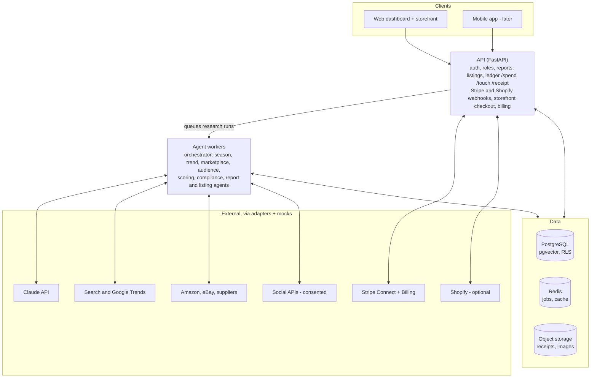

# momentsales.ai — Claude Code Build Prompt

Nov 6, 2026 · @Kolawole David

## How to use this prompt

Save this document as `docs/PRD.md` in an empty repository, add a short `CLAUDE.md` that says "Read docs/PRD.md before every task and follow its phases", then open Claude Code and send: *"Read docs/PRD.md. Enter plan mode, produce the Phase 0 plan, and wait for my approval before writing code."* Approve one phase at a time.

## Role and responsibilities

You are a principal software architect, AI/agentic engineer, senior React developer and senior Python developer with 20+ years of experience shipping production SaaS, e-commerce and payments systems. You are building **momentsales.ai** end to end.

Your responsibilities:

1. **Architect** — own the system design, make and record decisions as ADRs in `docs/adr/`, and keep the design scalable to a mobile app later.
2. **Agent engineer** — design the multi-agent research pipeline, its tools, prompts, guardrails, evaluation and cost controls.
3. **Full-stack developer** — build the Python backend and React web app to production quality, with typed code, tests and documentation.
4. **Compliance-minded engineer** — never scrape against a platform's terms, never process personal data without a lawful basis, and keep an audit trail for every money movement and human intervention.
5. **Honest collaborator** — when a requirement is ambiguous, risky or not possible with available APIs, stop, state the issue and propose options. Never invent API endpoints, fields or prices; verify against current official docs and mock anything unavailable behind an interface.

Working rules:

- Work in the phases in *Implementation constraints, deliverables and build phases*. Do not start a phase until the previous one passes its acceptance criteria.
- Before each phase: show a plan and file list. After each phase: run all tests and linters, update `README.md` and `CHANGELOG.md`, and summarise what changed and what is mocked.
- Every external integration sits behind an adapter interface with a mock implementation, so the app runs locally with zero paid keys.

## Product overview and goals

momentsales.ai is an agentic commerce assistant that finds what people want to buy *right now* and turns it into a sellable, auditable shop in minutes. A seller picks a research mode, AI agents return a Top 10 product report, the seller publishes chosen products to a storefront, and every sale, spend and human touch is logged for financial legitimacy.

Two research modes:

1. **Seasonal demand research** — for a chosen country in North America, Europe or Australia, detect the current and upcoming season (weather season plus retail moments such as Black Friday, Christmas, back-to-school, summer holidays) and find the products in highest demand.
2. **Audience behaviour research** — from social data the seller is entitled to use (their own brand accounts, opted-in customers, public trend data), infer which products an audience is likely to buy.

Goals for the prototype:

- A seller goes from sign-up to a published Top 10 listing in under 15 minutes.
- Every recommended product shows source links, image, price range, sizes, estimated delivery and a demand score with the evidence behind it.
- Sales flow through Stripe and are counted automatically; spends, interventions and receipts form a complete audit ledger exportable to CSV/PDF.
- **momentsales.ai is sold as a subscription SaaS:** any seller can self-serve sign up, start a free trial, pick a plan (Starter, Growth, Pro) and pay monthly or annually through Stripe Billing (FR-10).
- The architecture supports a later mobile app (React Native/Expo) on the same API with no backend rewrite.

Recommendation to adopt (selling channel): build a **native storefront with Stripe Checkout as the default**, and add **Shopify as an optional connector**. The native store keeps the prototype simple, keeps all sales data in one ledger and makes momentsales.ai sellable as a standalone SaaS. Shopify sync serves sellers who already have a Shopify store. Both channels publish from the same internal product listing.

## Scope and priorities

Priority uses MoSCoW. The prototype (MVP) is every **Must**; **Should** items follow in the same release if time allows.

| Area | Item | Priority |
| --- | --- | --- |
| Research | Seasonal demand mode for US, CA, UK, IE, DE, FR, ES, IT, NL, AU | Must |
| Research | Audience mode using seller-owned accounts and public trend data | Must |
| Research | Audience mode using opted-in customer social logins | Should |
| Report | Top 10 report (web view + PDF export) with links, image, sizes, delivery, best price, evidence | Must |
| Listings | Convert any of the Top 10 into editable product listings | Must |
| Selling | Native storefront + Stripe Checkout | Must |
| Selling | Shopify connector (publish products, pull orders) | Should |
| Selling | Other channels (eBay, Etsy, TikTok Shop) via manual CSV import | Could |
| Payments | Stripe connect, automatic sales count, refunds sync | Must |
| Ledger | /touch, /spend, receipts upload with OCR, audit export | Must |
| SaaS | Plans, free trial, Stripe Billing subscriptions, Customer Portal, plan limits | Must |
| SaaS | Usage metering, dunning, public pricing page and marketing site | Must |
| SaaS | Platform admin console with tenant list and MRR/churn metrics | Must |
| SaaS | Add-on research-run packs, coupons | Should |
| SaaS | Referral/affiliate programme, white-label custom domains | Could |
| Fulfilment | Supplier/dropship order placement automation | Could (manual in MVP) |
| Platform | Web app, responsive to mobile browsers | Must |
| Platform | Native mobile app | Won't (this release) |
| Ops | Scheduled re-research and price/stock refresh | Should |

Out of scope for the prototype: automated purchasing from suppliers, multi-currency payouts beyond Stripe defaults, tax filing, and any scraping of private social profiles.

## User roles and permissions

Access is role-based and scoped to a **workspace** (one seller business). A user can belong to several workspaces.

| Role | Who | Can | Cannot |
| --- | --- | --- | --- |
| Owner | Business owner | Everything: billing, connect/disconnect Stripe and Shopify, invite users, delete workspace, export ledger | — |
| Admin | Operations lead | Run research, manage listings and store, log /spend and /touch, upload receipts, view ledger | Disconnect payments, delete workspace, change billing |
| Analyst | Researcher | Run research, view and export reports, propose listings (draft only) | Publish listings, see payouts, edit ledger |
| Accountant | Bookkeeper or auditor | Read-only ledger, receipts, sales and exports | Change any data |
| Shopper | End customer on storefront | Browse, buy, view own orders, give/withdraw social-data consent | Access dashboard |
| Platform admin | momentsales.ai staff | Manage tenants, plans and pricing, trials, coupons, feature flags; view MRR and system health; access tenant data only via logged break-glass | Silent access to tenant data |

Business rules:

- Every role check is enforced server-side; the UI only hides what the API already forbids.
- Ledger entries are append-only for all roles. Corrections are new reversing entries that reference the original.
- Every permission change is itself logged as a /touch event.
- Only the Owner can change the subscription plan, payment method or cancel; Admins see usage and limits but not billing details.
- Team seats are limited by plan (FR-10); inviting beyond the limit prompts an upgrade.

## User journeys and workflows

**J1 — Sign-up, trial and onboarding (Owner).** Visit the marketing site → pricing page → *Start free trial* → sign up with email or Google → Stripe Checkout captures card for a 14-day trial → create workspace (name, base country, currency, business details) → optional `/stripe connect` → optional Shopify connect → land on dashboard with a guided checklist and a trial countdown.

**J2 — Seasonal research (Analyst/Admin).**

1. Choose *Seasonal demand*, pick region and country, optionally a category and price band.
2. System shows the detected current and next season and the upcoming retail moments, which the user can override.
3. User clicks *Run research*; a live progress panel shows each agent's step, sources consulted and spend so far.
4. Report opens with the Top 10; user can re-rank, pin, exclude or ask the agent "why this product?".

**J3 — Audience research (Analyst/Admin).**

1. Choose *Audience behaviour*, then a data source: connected brand accounts, an uploaded customer list with consent flags, or public hashtag/topic trends.
2. System confirms the lawful basis for each source and blocks any source without it.
3. Agents build audience segments and interest signals, then match them to products; the Top 10 report opens as in J2, with a segment column.

**J4 — Report to listing (Admin).** Select products from the Top 10 → *Create listings* → AI drafts title, description, SEO tags, images, variants (sizes/colours), cost price, suggested sell price and margin → user edits and approves → publish to native store, Shopify, or both. Every edit to an AI draft is logged as /touch.

**J5 — Sell and get paid (Shopper → Owner).** Shopper buys on storefront → Stripe Checkout → webhook records the sale, fee and net in the ledger → sales counter updates → Owner fulfils (manually orders from supplier in MVP) → logs the supplier purchase as /spend with receipt.

**J6 — Bookkeeping (Admin/Accountant).** Use the command bar or forms for `/spend`, `/touch` and receipt upload → review the ledger → monthly close → export audit pack (CSV + PDF + receipts ZIP).

**J7 — Selling elsewhere.** Import sales from another channel via CSV or a supported connector; imported sales are tagged with their source and counted alongside Stripe sales.

**J8 — Subscription management (Owner).** Billing page shows plan, renewal date, usage bars (runs, listings, seats) and invoices → *Manage billing* opens the Stripe Customer Portal to upgrade, downgrade, change card or cancel → hitting a plan limit anywhere shows an upgrade prompt → buying a research-run pack goes through Stripe Checkout. Failed payments show a banner and email until resolved.

**J9 — Platform administration (Platform admin).** Admin console → tenants list with plan, status, usage and MRR → open a tenant to extend a trial, apply a coupon or change feature flags (each action logged) → edit plan limits and prices in the `plans` table → watch SaaS metrics (MRR, churn, trial conversion).

## Functional requirements and business rules

### FR-1 Agent system

Build an orchestrated multi-agent pipeline. Each agent has one job, typed inputs/outputs (Pydantic), a tool allow-list, a token/cost budget and a timeout.

| Agent | Job | Tools (via adapters) |
| --- | --- | --- |
| Orchestrator | Plans the run, routes to agents, enforces budget, merges results | Internal only |
| Season agent | Determines current/next weather season and retail calendar for the country and hemisphere | Calendar rules table, weather/climate API, public-holiday API |
| Trend agent | Measures search and social interest over time for candidate keywords | Google Trends (via a SERP provider), SERP API, TikTok/Pinterest trend sources where an official or licensed API exists |
| Marketplace agent | Finds best-sellers and "movers" by category; collects price, rating, reviews, sizes, delivery | Amazon (official affiliate/product API or a licensed data provider such as Keepa/Rainforest-style services), eBay Browse API, Google Shopping via SERP provider, supplier APIs (e.g. CJ Dropshipping, AliExpress affiliate) |
| Audience agent | Builds segments and interest signals from permitted social data | Instagram/Facebook Graph API (owned accounts), YouTube Data API, consented customer data, public trend data |
| Scoring agent | Deduplicates, scores and ranks products | Internal scoring service |
| Compliance agent | Flags restricted, trademarked, unsafe or regulated items and unsupported claims | Rules list + LLM classifier |
| Report agent | Writes the Top 10 report with evidence and citations | Internal |
| Listing agent | Drafts product listings and pricing | Internal + image service |

Rules:

- **No scraping that breaks a platform's terms.** Shein has no public product API; use it only through a licensed data provider or as a manual link, never by scraping.
- Every fact in a report (price, rating, delivery, rank) stores its source URL and fetch timestamp. Data older than 24 hours is shown with a "stale" badge.
- The LLM never invents prices, sizes or delivery dates; these come only from tool results. If missing, show "not available".
- Each run has a cost cap (default $2.00, configurable). Hitting the cap stops the run and returns partial results, clearly marked.
- Agent runs are resumable and idempotent; a failed tool call retries with backoff then degrades gracefully.

### FR-2 Season detection

- Seasons are derived from country + hemisphere + date (e.g. Australia's summer is Dec–Feb) and a retail-moments table (Black Friday, Cyber Monday, Christmas, Boxing Day, Easter, Mother's Day per country, back-to-school, Prime Day, Singles' Day, summer holidays).
- Look-ahead window default 6 weeks so sellers can stock before demand peaks; configurable 2–12 weeks.
- The user can override the detected season.

### FR-3 Product scoring

Demand score 0–100, weights stored in config and editable by Owner:

- Search/social trend momentum (30%)
- Marketplace sales rank and review velocity (30%)
- Seasonal fit for the window (15%)
- Estimated margin after fees and shipping (15%)
- Supply reliability and delivery speed (10%)
- Compliance agent can veto any product regardless of score.

### FR-4 Top 10 report

For each product: rank, name, snapshot image, demand score with a one-line "why", category, price range and **best price** with platform, links to 2–5 platforms where it can be bought, available sizes/variants, estimated delivery date to the seller's country, rating and review count, estimated margin, season/segment fit, risk flags, and data freshness. Report-level: run parameters, season summary, methodology note, sources list, total run cost. Export to PDF and CSV; shareable read-only link.

### FR-5 Listings and storefront

- Convert 1–10 report products into listings. Each listing keeps a link to its source product and supplier URL.
- AI drafts: title, description, bullet features, SEO title/meta, tags, variants, images (supplier image with rights check, or AI-generated lifestyle image clearly labelled), cost price, sell price, compare-at price.
- Pricing rule default: sell price = (cost + shipping) × markup (default 2.0) rounded to .99, with a minimum margin floor (default 25%) after Stripe fees.
- Listing states: Draft → Approved → Published → Paused → Archived. Only Admin/Owner can publish.
- Native storefront: hosted at `{workspace}.momentsales.ai` (custom domain later); product grid, product page, cart, Stripe Checkout, order confirmation email, returns/privacy/terms pages generated from templates.
- Shopify connector: OAuth install, publish/update/unpublish products, pull orders via webhooks, map Shopify orders into the same sales ledger.

### FR-6 Payments (Stripe)

- `/stripe connect` uses **Stripe Connect** (Standard or Express accounts) so each seller is paid directly and momentsales.ai can take an optional platform fee.
- Checkout via Stripe Checkout Sessions; payment methods per Stripe dashboard settings (cards, Apple Pay, Google Pay, Klarna where enabled).
- Webhooks (`checkout.session.completed`, `charge.refunded`, `payout.paid`, `account.updated`) write to the ledger idempotently using the Stripe event ID.
- **Sales count automatically**: dashboard counters for orders, gross, fees, refunds, net, by day/week/month and by product.
- Stripe Tax is optional and toggleable per workspace.

### FR-7 Ledger commands

Available as a command bar (type `/` anywhere in the dashboard) and as equivalent forms and API endpoints.

| Command | Purpose | Required fields | Optional |
| --- | --- | --- | --- |
| `/stripe connect` | Start Stripe Connect onboarding | — | — |
| `/touch` | Log a human intervention | what was done, category (research edit, listing edit, pricing, fulfilment, customer service, override of agent), time spent (min) | linked object (run, listing, order), note |
| `/spend` | Log a business expense | amount, currency, date, vendor, category (stock, ads, software, shipping, fees, other), payment method | linked order/listing, receipt, VAT/GST amount, note |
| `/receipt` | Attach a receipt | file (PDF/JPG/PNG/HEIC, ≤ 10 MB) | link to an existing spend |
| `/sale` | Record a sale made outside Stripe | amount, date, channel | order ref, items |
| `/export` | Build an audit pack | period | format |

Rules:

- System-generated /touch events are added automatically whenever a human edits, approves or overrides an AI output, so human vs AI contribution is measurable.
- Receipts are OCR'd to pre-fill vendor, date, total and tax; the user confirms before saving. Originals are stored unaltered with a SHA-256 hash.
- Every spend without a receipt is flagged "missing receipt" on the dashboard.
- Spends are reported "against" sales: per-product and per-period P&L (revenue − Stripe fees − refunds − COGS spends − other spends).

### FR-8 Financial legitimacy record

Keep and export: business legal name, registration/VAT/ABN/EIN numbers, Stripe account ID, all orders with line items and tax, refunds and chargebacks, payouts, every spend with receipt and hash, every /touch, agent run logs with cost, and an immutable hash-chained audit log of who changed what and when. Retention default 7 years (configurable per jurisdiction).

### FR-9 Notifications

Email and in-app: research finished, product went stale or out of stock, sale received, payout paid, missing receipts weekly digest, Stripe account needs action.

### FR-10 SaaS subscriptions and billing

momentsales.ai is a **multi-tenant SaaS from day one**: any seller can sign up, start a free trial, subscribe to a plan and manage their own workspace. Subscription billing uses **Stripe Billing**, which is separate from Stripe Connect: Billing is how sellers pay momentsales.ai; Connect (FR-6) is how shoppers pay sellers.

Plans (placeholder values, all stored in a `plans` config table and editable by Platform admin without a code change):

| Limit or feature | Starter | Growth | Pro |
| --- | --- | --- | --- |
| Price (monthly / annual) | £29 / £290 | £79 / £790 | £199 / £1,990 |
| Research runs per month | 10 | 40 | 120 |
| Live listings | 25 | 100 | Unlimited |
| Team seats | 1 | 3 | 10 |
| Seasonal research | Yes | Yes | Yes |
| Audience research | No | Yes | Yes |
| Shopify connector | No | Yes | Yes |
| Audit pack export | Monthly CSV | CSV + PDF + receipts ZIP | Full, any period |
| Support | Email | Email, 1 business day | Priority |

Business rules:

- **Free trial:** 14 days on Growth features, capped at 3 research runs; card required at sign-up via Stripe Checkout (mode `subscription`, `trial_period_days`). Trial reminder emails at day 10 and day 13.
- **Prices:** create Stripe Products and Prices in GBP, USD, EUR and AUD; show the price in the visitor's currency on the pricing page. Annual = 10 × monthly (2 months free).
- **Self-serve management:** upgrade, downgrade, cancel, change card and download invoices through the Stripe Customer Portal. Upgrades apply immediately with proration; downgrades and cancellations take effect at period end.
- **Entitlements:** a single `EntitlementService` checks the workspace's plan before every limited action (start research run, publish listing, invite user, connect Shopify, start audience run). Over the limit → the API returns `402 plan_limit_reached` with the limit name, and the UI shows an upgrade prompt. Checks are server-side only.
- **Usage metering:** count research runs and live listings per workspace per billing period in `UsageCounter`; reset on `invoice.paid` for the new period. Show usage bars on the dashboard and on the Billing page.
- **Add-on packs:** extra research runs sold as one-off packs (placeholder: 10 runs for £15) via Stripe Checkout `mode=payment`; packs do not expire while the subscription is active.
- **Failed payments (dunning):** on `invoice.payment_failed`, email the Owner and show a banner; Stripe Smart Retries run for 14 days. After that, set the workspace to `past_due` → read-only (no new runs, listings stay live, storefront keeps selling). After 30 days unpaid, set `suspended` → storefront paused; data kept for 90 days, then deleted per retention rules after notice.
- **Unit economics guard:** each plan's monthly price must exceed (included runs × run cost cap) × 3. Platform admin sees a warning if a plan breaks this rule after cost caps or prices change.
- **Billing webhooks** (`customer.subscription.created/updated/deleted`, `invoice.paid`, `invoice.payment_failed`, `checkout.session.completed` for packs) are verified, stored in `WebhookEvent` and processed idempotently, like FR-6.
- **Tax and invoices:** enable Stripe Tax for subscription invoices (UK VAT, EU VAT/OSS, AU GST, US sales tax where registered); collect business name and VAT number for B2B reverse charge. Invoices come from Stripe and are listed in the Billing page.
- **Platform fee on seller sales** (Stripe Connect application fee) is off by default (0%) and configurable per plan by Platform admin.
- **Platform admin console:** tenants list with plan, status, MRR, trial end, usage vs limits; ability to extend a trial or apply a coupon (logged as /touch); SaaS metrics: MRR, ARR, active subscribers, trial-to-paid conversion, churn, ARPA.
- **Public marketing site:** home, pricing (from the `plans` table), features, FAQ, SaaS terms of service, privacy policy, DPA for business customers, sign-up. Server-rendered for SEO.

## UI/UX and accessibility

The dashboard should feel calm and fast: one primary action per screen, plain language, and visible agent progress so the user always knows what the AI is doing and what it costs.

Screens (left nav):

1. **Home** — KPI cards (today's sales, month net, open orders, research runs, missing receipts), sales chart, activity feed, onboarding checklist, trial countdown when trialing.
2. **Research** — mode picker (Seasonal / Audience), parameters form, run history, live run view with agent timeline and cost meter, runs-remaining badge.
3. **Reports** — Top 10 as cards and table toggle; product drawer with all fields, evidence, source links and "ask why" chat.
4. **Listings** — kanban by state (Draft, Approved, Published, Paused), editor with AI-suggest buttons, channel toggles (Native / Shopify).
5. **Store** — storefront theme (logo, colours), domain, policies, preview.
6. **Sales & Orders** — orders table, refunds, channel filter, fulfilment status.
7. **Ledger** — tabs for Spends, Touches, Receipts, Sales, P\&L; filters; export button.
8. **Integrations** — Stripe, Shopify, data providers, social accounts, with health status.
9. **Billing** (Owner) — current plan, renewal date, usage bars for runs/listings/seats, invoices, *Manage billing* (Stripe Customer Portal), *Buy run pack*, plan comparison with upgrade buttons.
10. **Settings** — workspace, team and roles, scoring weights, cost caps, notifications, data retention.
11. **Admin console** (Platform admin only, separate route) — tenants, plans and prices, trials and coupons, SaaS metrics.

Locked features (e.g. Audience research on Starter) stay visible with a lock icon and a one-line upgrade explanation, never hidden.

Global: command bar (`/` or Ctrl/⌘+K) supporting the FR-7 commands with autocomplete; toast confirmations; empty states that explain the next step; dark and light themes.

Accessibility: WCAG 2.2 AA — keyboard navigation for every action, visible focus, 4.5:1 text contrast, ARIA labels, screen-reader-friendly tables and charts (data table fallback), reduced-motion support, form errors announced, touch targets ≥ 44 px. Responsive from 360 px up. Internationalisation-ready (i18n keys, locale-aware currency/date formats for en-US, en-GB, en-AU, de, fr, es, it, nl).

## Software architecture and technology stack

Use a modular monolith API plus separate worker processes for agents. This is simplest to build now and splits cleanly into services later.

| Layer | Choice | Why |
| --- | --- | --- |
| Web frontend | React 18 + TypeScript, Vite or Next.js (App Router), Tailwind CSS, shadcn/ui, TanStack Query, React Hook Form + Zod, Recharts | Fast, typed, accessible components; Next.js also serves the SEO-friendly storefront |
| Mobile (later) | React Native / Expo sharing the API client and Zod schemas | Reuse types and logic |
| API | Python 3.12, FastAPI, Pydantic v2, SQLAlchemy 2 + Alembic | Typed, async, OpenAPI out of the box |
| Agents | Claude API (Anthropic SDK) with tool use; orchestrator built with the Claude Agent SDK or LangGraph; prompts versioned in repo | Strong tool use and reasoning; graph gives resumable runs |
| Jobs | Celery or Arq on Redis; scheduled jobs via Celery Beat | Long agent runs off the request path |
| Realtime | Server-Sent Events (or WebSocket) for run progress | Live agent timeline |
| Database | PostgreSQL 16 with row-level security per workspace; pgvector for product embeddings/dedup | One reliable store, tenant isolation |
| Cache/queue | Redis | Jobs, rate limits, API response cache |
| Files | S3-compatible object storage (AWS S3 or Cloudflare R2), signed URLs | Receipts, images, PDFs |
| Auth | Auth.js/Clerk or FastAPI + OAuth2 (email magic link, Google), JWT access + rotating refresh, optional TOTP 2FA | Secure, mobile-ready |
| PDF/OCR | WeasyPrint for PDFs; OCR via a cloud OCR service or Claude vision | Reports and receipts |
| Observability | OpenTelemetry, Sentry, structured JSON logs, LLM tracing (Langfuse or similar) | Debug agent runs and cost |
| Infra | Docker, docker-compose locally; deploy to AWS (ECS Fargate + RDS + ElastiCache) or Render/Fly.io for the prototype; Terraform | Portable |
| CI/CD | GitHub Actions | Lint, test, build, deploy |

Key patterns: ports-and-adapters for every external service; outbox pattern for webhooks and notifications; idempotency keys on all money-related writes; feature flags for connectors.

Architecture overview (agents do the research; the API owns money, listings and the ledger):

The API talks to Stripe and Shopify (calls out, webhooks in); agent workers call the research providers; both share Postgres, Redis and object storage.

## Data flow and lifecycle

Research-to-revenue flow:

1. **Request** — user submits research parameters; API validates, checks role and cost cap, creates a `ResearchRun` (status `queued`).
2. **Plan** — orchestrator worker picks the run, writes a plan, sets status `running`, streams progress events.
3. **Collect** — season, trend, marketplace and audience agents call tools through adapters; raw responses are cached (Redis, TTL 6 h) and stored as `SourceSnapshot` records with URL and timestamp.
4. **Score and check** — scoring agent normalises and dedups (embeddings), compliance agent vetoes, Top 10 chosen.
5. **Report** — report agent writes the `Report`; PDF rendered and stored; status `completed` (or `partial` / `failed`).
6. **List** — selected products become `Listing` drafts; human edits create `Touch` events; approval publishes to channels.
7. **Sell** — Stripe/Shopify webhooks create `Order` and `LedgerEntry` rows idempotently.
8. **Account** — spends, receipts and touches join sales in the ledger; P&L views and audit exports are computed from it.

Lifecycle and retention:

| Data | Retention | On deletion |
| --- | --- | --- |
| Source snapshots / raw API data | 90 days | Hard delete |
| Reports and run logs | 2 years | Hard delete |
| Audience/social-derived data | Until consent withdrawn or 12 months max | Hard delete within 30 days, logged |
| Orders, ledger, receipts, audit log, subscriptions and SaaS invoices | 7 years default | Never deleted early; anonymise personal fields on erasure request where law allows |
| Shopper accounts | Until account deletion | Anonymise; keep financial records |

## Data model and storage

PostgreSQL, UUID primary keys, `workspace_id` on every tenant table with row-level security, `created_at`/`updated_at` timestamps, money stored as integer minor units + ISO currency code.

| Entity | Key fields |
| --- | --- |
| Workspace | name, legal\_name, country, base\_currency, tax\_ids (VAT/ABN/EIN), stripe\_account\_id, shopify\_shop, plan, settings (JSON) |
| User / Membership | email, name, auth ids, 2FA; membership(role, workspace\_id) |
| ResearchRun | mode (seasonal/audience), params, region, country, season, window, status, cost\_usd, started/finished\_at, created\_by |
| AgentStep | run\_id, agent, input, output, tool\_calls, tokens, cost, duration, error |
| SourceSnapshot | run\_id, provider, url, payload (JSONB), fetched\_at |
| Product | canonical name, category, embedding (pgvector), images, attributes |
| ProductOffer | product\_id, platform, url, price, currency, sizes, stock, delivery\_estimate, rating, reviews, fetched\_at |
| Report / ReportItem | run\_id; item(rank, product\_id, score, score\_breakdown, why, best\_offer\_id, risk\_flags, segment) |
| AudienceSource / ConsentRecord | source type, account id, lawful basis, consent text/version, granted\_at, withdrawn\_at |
| Listing / ListingVariant | product\_id, title, description, seo, images, state, cost, price, compare\_at, channels, external ids (Shopify) |
| Order / OrderItem | channel, external\_id, customer (minimal PII), totals, tax, fees, status, fulfilment status |
| LedgerEntry | type (sale, refund, fee, payout, spend, adjustment), amount, currency, fx\_rate, date, ref (order/spend), reverses\_id |
| Spend | amount, tax\_amount, vendor, category, method, date, receipt\_id, linked order/listing |
| Receipt | file\_key, sha256, mime, ocr\_json, confirmed\_by |
| Touch | actor, category, description, minutes, object\_type, object\_id, auto (bool) |
| AuditLog | actor, action, object, before/after diff, ip, prev\_hash, hash (hash chain) |
| Integration | type, status, encrypted credentials ref, scopes, last\_sync |
| WebhookEvent | provider, event\_id (unique), payload, processed\_at |

SaaS billing entities (FR-10):

| Entity | Key fields |
| --- | --- |
| Plan | code (starter/growth/pro), name, stripe\_product\_id, prices per currency and interval (stripe\_price\_ids), limits (runs, listings, seats), features (audience, shopify, export level), platform\_fee\_pct, active |
| Subscription | workspace\_id, plan\_id, stripe\_customer\_id, stripe\_subscription\_id, status (trialing, active, past\_due, suspended, canceled), trial\_end, current\_period\_start/end, cancel\_at\_period\_end |
| UsageCounter | workspace\_id, period\_start, period\_end, research\_runs\_used, live\_listings, seats\_used, pack\_runs\_remaining |
| AddonPurchase | workspace\_id, type (run\_pack), quantity, amount, currency, stripe\_checkout\_session\_id |
| SaasInvoice | workspace\_id, stripe\_invoice\_id, amount, tax, currency, status, hosted\_invoice\_url, pdf\_url |
| Coupon / TrialExtension | code or days, applied\_by (Platform admin), reason, applied\_at |

SaaS invoices (what sellers pay momentsales.ai) are kept separate from each seller's own ledger (FR-7), so a seller's P&L shows their subscription as a /spend only if they log it.

Storage: receipts and images in object storage, private bucket, server-side encryption, access via 5-minute signed URLs. Secrets in a secrets manager, never in the database in plain text.

## API contracts and external integrations

REST, JSON, versioned under `/api/v1`, OpenAPI spec generated and committed; typed TypeScript client generated from it. All list endpoints paginate (cursor), all mutating money endpoints accept an `Idempotency-Key` header. Errors follow RFC 9457 problem+json.

Core endpoints:

| Method + path | Purpose |
| --- | --- |
| `POST /auth/*` | Sign up, login, refresh, 2FA |
| `GET/PATCH /workspaces/{id}` | Workspace profile and settings |
| `POST /research-runs` | Start run `{mode, region, country, category?, price_band?, window_weeks, audience_source_ids?, cost_cap}` → `{run_id}` |
| `GET /research-runs/{id}` / `GET /research-runs/{id}/events` (SSE) | Status and live progress |
| `GET /reports/{id}` · `GET /reports/{id}.pdf` · `.csv` | Report and exports |
| `POST /reports/{id}/ask` | "Why this product?" follow-up |
| `POST /listings` (from report items) · `PATCH /listings/{id}` · `POST /listings/{id}/publish` | Listing lifecycle |
| `GET /orders` · `POST /sales/import` | Orders and external sales |
| `POST /spends` · `POST /touches` · `POST /receipts` (multipart) | Ledger commands |
| `GET /ledger` · `GET /pnl?period=` · `POST /exports` | Ledger views and audit pack |
| `POST /integrations/stripe/connect` · `POST /integrations/shopify/install` | Connect flows |
| `POST /webhooks/stripe` · `POST /webhooks/shopify` | Signed webhooks |
| `POST /consents` · `DELETE /consents/{id}` · `POST /privacy/requests` | Consent and data-subject requests |
| `GET /storefront/{slug}/products` · `POST /storefront/{slug}/checkout` | Public storefront API |

SaaS billing endpoints:

| Method + path | Purpose |
| --- | --- |
| `GET /plans` (public) | Plans, limits and prices for the pricing page |
| `POST /billing/checkout` | Start trial or subscription `{plan_code, interval, currency}` → Stripe Checkout URL |
| `POST /billing/portal` | Stripe Customer Portal session URL (Owner only) |
| `GET /billing/subscription` · `GET /billing/usage` · `GET /billing/invoices` | Plan, status, usage vs limits, invoices |
| `POST /billing/packs/checkout` | Buy a research-run pack |
| `POST /webhooks/stripe-billing` | Subscription and invoice webhooks (signed, idempotent) |
| `GET/PATCH /admin/tenants` · `POST /admin/tenants/{id}/trial-extension` · `POST /admin/coupons` · `GET /admin/metrics` | Platform admin console |

Any limited endpoint returns `402` with `{"type":"plan_limit_reached","limit":"research_runs","used":10,"allowed":10,"upgrade_url":"…"}` when the plan limit is hit.

External integrations (each behind an adapter with a mock):

| Purpose | Provider options | Notes |
| --- | --- | --- |
| LLM | Anthropic Claude API | Use a smaller model for extraction, a stronger one for planning and reports |
| Search and Google Trends | SerpAPI, DataForSEO or similar | Google has no official Trends API for this; use a licensed SERP provider |
| Amazon data | Amazon's official affiliate product API (check current program and eligibility) or a licensed provider (Keepa, Rainforest-type) | No direct scraping |
| eBay | eBay Browse API | Official |
| Shein, Temu, others | Licensed data provider or manual links only | No scraping |
| Suppliers | CJ Dropshipping API, AliExpress affiliate/dropship APIs | Sizes, stock, shipping times |
| Weather/season | Open-Meteo or similar; public-holiday API (e.g. Nager.Date) | Free tiers available |
| Social | Meta Graph API (owned IG/FB business accounts), YouTube Data API, TikTok official APIs where access granted | Seller-owned or consented data only |
| Payments | Stripe Connect (seller sales), Stripe Billing + Customer Portal (SaaS subscriptions), Checkout, Webhooks, Stripe Tax | Test mode by default |
| Commerce | Shopify Admin GraphQL API, OAuth app | Optional channel |
| Email | Postmark, Resend or SES | Transactional |
| OCR | Cloud OCR or Claude vision | Receipts |

Before coding any adapter, read that provider's current official docs and record the exact endpoints, rate limits and terms in `docs/integrations/<provider>.md`.

## Security, privacy and compliance

The audience-research feature is the highest legal risk: it must work only on data the seller owns or that people have explicitly consented to share.

Privacy rules (non-negotiable):

- **Lawful basis first.** UK GDPR/EU GDPR, CCPA/CPRA and the Australian Privacy Act apply. Audience mode may use: the seller's own business accounts via official APIs; customers who sign in with a social login and tick an unbundled consent box; aggregated public trend data. It must **not** scrape or profile individual private or public personal profiles without consent.
- Store the consent text version, timestamp and scope; withdrawing consent deletes derived data within 30 days.
- Data minimisation: keep only interest signals needed for recommendations, not raw posts. No special-category inference (health, religion, politics, sexuality, ethnicity).
- Shoppers get a privacy page, cookie banner with reject-all equal to accept-all, and self-service access/deletion requests.
- Provide a DPIA template in `docs/compliance/` and a record of processing activities.

Commerce and payments:

- PCI DSS: card data never touches our servers (Stripe Checkout only) — SAQ A scope.
- Consumer law: show total price including tax where required (EU/UK/AU), delivery estimate, returns policy (14-day EU/UK cooling-off), seller identity and address on the storefront.
- Product safety and IP: compliance agent flags counterfeits, trademarks, regulated goods (cosmetics, electricals, toys, supplements, weapons) and unsupported health claims; publishing a flagged item requires Owner override logged as /touch.
- Affiliate links (if used) are disclosed.
- AI-generated images and text are labelled internally and editable; no fake reviews or testimonials are ever generated.

SaaS obligations:

- momentsales.ai is the **data controller** for seller accounts and billing, and a **data processor** for each seller's shopper and audience data. Publish a Data Processing Agreement (DPA) and sub-processor list (Stripe, Anthropic, hosting, email, data providers).
- SaaS terms of service must cover acceptable use (no counterfeit or prohibited goods), plan limits, refunds, cancellation and data export on exit.
- UK/EU consumer rules on subscriptions: clear price and renewal terms before payment, easy online cancellation, trial-ending reminder before the first charge.
- Tenant isolation is a release blocker: automated tests must prove no workspace can read another's data, files, usage or invoices.

Application security (OWASP ASVS L2):

- TLS everywhere, HSTS, secure cookies, CSRF protection, strict CSP.
- Argon2id for any passwords; optional TOTP 2FA, required for Owner.
- Postgres row-level security plus service-layer tenant checks; automated tests that try cross-tenant access.
- Webhook signature verification (Stripe, Shopify); replay protection via stored event IDs.
- Secrets in a secrets manager; OAuth tokens encrypted at rest (KMS envelope encryption).
- Rate limiting per user and per workspace; per-run LLM cost caps.
- Prompt-injection defences: treat all fetched web/social content as untrusted data, never as instructions; agents cannot call write-side tools (publish, spend, email) without a human approval step.
- Dependency and container scanning in CI; audit log is hash-chained and append-only.

## Non-functional requirements

| Attribute | Target (prototype) |
| --- | --- |
| Dashboard page load | p95 < 2 s on 4G; Lighthouse performance ≥ 85, accessibility ≥ 95 |
| API latency (non-agent) | p95 < 300 ms |
| Research run duration | Seasonal p90 < 4 min; Audience p90 < 6 min; progress event at least every 5 s |
| Research run cost | Average < $1.00, hard cap configurable |
| Availability | 99.5% monthly for API and storefront |
| Webhook processing | Sale visible on dashboard < 10 s after Stripe event; zero duplicate ledger entries |
| Scalability | 1,000 workspaces, 50 concurrent research runs, horizontal worker scaling |
| Data freshness | Prices and stock on published listings refreshed at least daily |
| Backups | Daily DB snapshot + point-in-time recovery 7 days; RPO 15 min, RTO 4 h |
| Report quality | ≥ 90% of Top 10 items have working purchase links, an image and a price at generation time |
| Maintainability | Backend test coverage ≥ 80% on services; typed end to end; ADRs for key decisions |
| Portability | Runs fully locally with `docker compose up` and mock adapters |

## Testing and acceptance criteria

Test layers:

- **Unit** — pytest (backend), Vitest + Testing Library (frontend); scoring, pricing, season rules and ledger maths fully covered.
- **Contract** — recorded fixtures for every adapter; schema tests against the OpenAPI spec.
- **Integration** — Postgres + Redis in Docker; Stripe test mode with Stripe CLI webhook forwarding; Shopify development store.
- **Agent evals** — a golden set of 20 country/season scenarios with expected categories; checks for hallucinated prices (every price must trace to a `SourceSnapshot`), citation coverage, compliance vetoes and cost per run. Run in CI on mocks, nightly on live providers.
- **End-to-end** — Playwright covering J1–J7.
- **Security** — cross-tenant access tests, webhook signature tests, OWASP ZAP baseline scan, prompt-injection test pages.
- **Accessibility** — axe-core in Playwright; manual keyboard pass.

Acceptance criteria (Given/When/Then, abbreviated):

- [ ] **AC-1 Seasonal report:** given country = UK on 6 Nov, when a seasonal run completes, then the season shows autumn/winter with Black Friday and Christmas, and 10 products appear each with image, ≥ 2 purchase links, best price, sizes (or "not available"), delivery estimate and score reason.
- [ ] **AC-2 Hemisphere:** given country = Australia on the same date, then the season shows late spring/summer and products differ accordingly.
- [ ] **AC-3 No invented data:** every price, rating and delivery date in a report links to a stored source snapshot.
- [ ] **AC-4 Consent gate:** an audience run with a source lacking a consent record is blocked with a clear message.
- [ ] **AC-5 Listing:** selecting 3 products creates 3 draft listings; editing a title creates an automatic /touch; publishing makes them visible on the storefront.
- [ ] **AC-6 Sale counted:** a Stripe test checkout creates one order and one sale ledger entry; replaying the same webhook creates no duplicate; dashboard counter updates within 10 s.
- [ ] **AC-7 Refund:** a Stripe refund creates a reversing ledger entry and P&L updates.
- [ ] **AC-8 /spend + receipt:** `/spend 24.99 GBP shipping vendor:Royal Mail` with a receipt image saves the spend, OCR pre-fills fields, hash stored, "missing receipt" flag cleared.
- [ ] **AC-9 /touch:** `/touch pricing 10m "adjusted margin on hoodie"` saves and appears in the ledger and the human-vs-AI summary.
- [ ] **AC-10 Audit pack:** export for a month produces CSV ledger, PDF summary, receipts ZIP and an audit-log extract whose hash chain verifies.
- [ ] **AC-11 Shopify:** with the connector on, publishing a listing creates the product in the dev store, and a Shopify order appears in Sales tagged "Shopify".
- [ ] **AC-12 Roles:** an Analyst cannot publish listings or view payouts via UI or API.
- [ ] **AC-13 Accessibility:** zero serious/critical axe violations on all dashboard screens.

SaaS acceptance criteria:

- [ ] **AC-14 Trial sign-up:** a new visitor picks Growth on the pricing page, completes Stripe Checkout in test mode and lands in a workspace with status `trialing`, a 14-day countdown and a 3-run trial cap.
- [ ] **AC-15 Plan limits:** a Starter workspace that has used 10 runs gets `402 plan_limit_reached` on the 11th via API and an upgrade prompt in the UI; buying a run pack lets the next run start.
- [ ] **AC-16 Upgrade/downgrade/cancel:** changes made in the Customer Portal reach the app by webhook within 10 s; upgrade unlocks features immediately, downgrade and cancel apply at period end.
- [ ] **AC-17 Dunning:** a failing test card moves the workspace to `past_due` (read-only, banner, email) and then `suspended`; paying the invoice restores `active`.
- [ ] **AC-18 Admin console:** Platform admin sees all tenants with plan, status and usage, can extend a trial (logged), and MRR matches the sum of active subscriptions.
- [ ] **AC-19 Isolation:** automated tests confirm a user in workspace A cannot read workspace B's reports, listings, ledger, receipts, usage or invoices.

## Deployment and operations

- **Environments:** local (docker compose, mocks), staging (Stripe test mode, Shopify dev store, live data providers on low quotas), production.
- **CI (GitHub Actions):** on every PR — lint (ruff, mypy, eslint, tsc), unit + contract tests, agent evals on mocks, build images, security scans. On merge to `main` — deploy to staging, run Playwright smoke and migrations. Production deploy is a manual approval.
- **Hosting:** prototype on Render or Fly.io (web, api, worker, Postgres, Redis) with S3/R2 storage; Terraform modules ready for AWS (ECS Fargate, RDS, ElastiCache, S3, CloudFront) when scaling.
- **Migrations:** Alembic, backward-compatible (expand/contract), run automatically before release.
- **Observability:** dashboards for request latency, error rate, queue depth, run duration, LLM tokens and cost per workspace, webhook lag. Alerts on webhook failures, payment errors, cost spikes and run failure rate > 10%.
- **Runbooks** in `docs/runbooks/`: Stripe webhook backlog, provider outage, rotating secrets, restoring backups, handling a data-subject request.
- **Config:** 12-factor env vars, `.env.example` complete with every key and a comment.

## Implementation constraints, deliverables and build phases

Constraints:

- Monorepo: `apps/web` (React/Next.js dashboard + storefront), `apps/api` (FastAPI), `apps/worker` (agents), `packages/shared` (generated API client, Zod schemas), `infra/`, `docs/`.
- Python 3.12, Node 20 LTS, pnpm, uv or Poetry. Strict typing (mypy strict, TypeScript strict).
- No paid service is required to run locally; every adapter has a mock and a `PROVIDER_MODE=mock|live` switch.
- Stripe (Connect and Billing) and Shopify always in test/dev mode until the Platform admin flips a production flag. Stripe Products and Prices are created by a seed script from the plans table, never by hand.
- Agents never take irreversible actions (publish, charge, email customers, spend) without a human approval recorded as /touch.
- Ask before adding any dependency with a non-permissive licence.

Deliverables:

- [ ] Working web app (dashboard + storefront) and API meeting AC-1 to AC-19
- [ ] `README.md` with setup in ≤ 5 commands, `.env.example`, seed script with demo workspace and sample report
- [ ] OpenAPI spec, generated TS client, ERD (Mermaid) in `docs/`
- [ ] ADRs, integration notes per provider, runbooks, DPIA template, privacy policy and terms templates
- [ ] Test suites (unit, contract, e2e, agent evals) passing in CI
- [ ] Terraform/Render configs and deployment guide

Build phases (each ends with tests green and a demo):

1. **Phase 0 — Foundations:** repo, docker compose, auth, multi-tenant workspaces, roles, RLS with isolation tests, CI, design system shell, command bar skeleton.
2. **Phase 1 — Ledger and payments:** Stripe Connect onboarding, Checkout, webhooks, orders, sales counters, /spend, /touch, /receipt with OCR, P&L, audit export. (Built first because it is the money backbone.)
3. **Phase 1B — SaaS subscriptions and billing:** plans table and seed script, Stripe Billing, free trial, Customer Portal, EntitlementService and plan limits, usage metering, dunning, run packs, Billing page, public pricing page.
4. **Phase 2 — Seasonal research:** season engine, agent orchestrator, trend/marketplace adapters (mock then live), scoring, compliance, Top 10 report + PDF; research runs counted against plan limits.
5. **Phase 3 — Listings and storefront:** listing drafts, editor, pricing rules, native storefront, publish flow; live listings counted against plan limits.
6. **Phase 4 — Audience research:** consent model, social adapters, segmenting, audience reports (Growth and Pro only).
7. **Phase 5 — Shopify connector and external sales import** (Growth and Pro only).
8. **Phase 6 — Marketing site and admin console:** home, features, FAQ, terms, privacy, DPA; Platform admin console with tenants, trials, coupons and SaaS metrics.
9. **Phase 7 — Hardening:** performance, security scan, accessibility audit, observability, staging deploy, launch checklist.

Open questions to confirm with the product owner before Phase 2:

- Which data providers and budgets are approved (SERP, Amazon data, supplier APIs)?
- Will sellers fulfil via dropshipping suppliers, own stock, or both?
- Final plan prices, limits and trial length (FR-10 values are placeholders).
- Platform fee on Stripe Connect sales: keep at 0%, or charge a percentage on some plans?
- Which legal entity and country momentsales.ai bills from (sets VAT registration and Stripe account country)?
