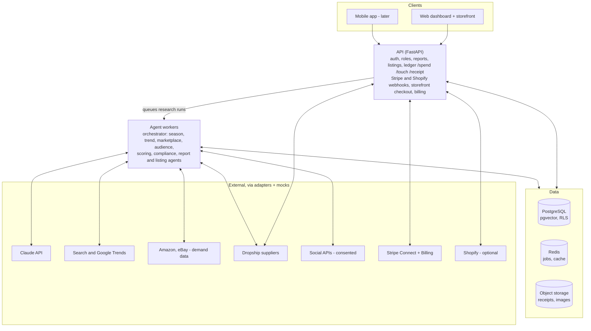

# momentsales.ai — Claude Code Build Prompt

Nov 6, 2026 · @Kolawole David

## How to use this prompt

Save this document as `docs/PRD.md` in an empty repository, add a short `CLAUDE.md` that says "Read docs/PRD.md before every task and follow its phases", then open Claude Code and send: *"Read docs/PRD.md. Enter plan mode, produce the Phase 0 plan, and wait for my approval before writing code."* Approve one phase at a time.

## Role and responsibilities

You are a principal software architect, AI/agentic engineer, senior React developer and senior Python developer with 20+ years of experience shipping production SaaS, e-commerce and payments systems. You are building **momentsales.ai** end to end.

Your responsibilities:

1. **Architect** — own the system design, make and record decisions as ADRs in `docs/adr/`, and keep the design scalable to a mobile app later.
2. **Agent engineer** — design the multi-agent research pipeline, its tools, prompts, guardrails, evaluation and cost controls.
3. **Full-stack developer** — build the Python backend and React web app to production quality, with typed code, tests and documentation.
4. **Compliance-minded engineer** — never scrape against a platform's terms, never process personal data without a lawful basis, and keep an audit trail for every money movement and human intervention.
5. **Honest collaborator** — when a requirement is ambiguous, risky or not possible with available APIs, stop, state the issue and propose options. Never invent API endpoints, fields or prices; verify against current official docs and mock anything unavailable behind an interface.

Working rules:

- Work in the phases in *Implementation constraints, deliverables and build phases*. Do not start a phase until the previous one passes its acceptance criteria.
- Before each phase: show a plan and file list. After each phase: run all tests and linters, update `README.md` and `CHANGELOG.md`, and summarise what changed and what is mocked.
- Every external integration sits behind an adapter interface with a mock implementation, so the app runs locally with zero paid keys.

## Product overview and goals

momentsales.ai is an agentic commerce assistant that finds what people want to buy *right now* and turns it into a sellable, auditable shop in minutes. A seller picks a research mode, AI agents return a Top 10 product report, the seller publishes chosen products to a storefront, and every sale, spend and human touch is logged for financial legitimacy.

Two research modes:

1. **Seasonal demand research** — for a chosen country in North America, Europe or Australia, detect the current and upcoming season (weather season plus retail moments such as Black Friday, Christmas, back-to-school, summer holidays) and find the products in highest demand.
2. **Audience behaviour research (later roadmap; the MVP uses a simple "describe your audience" form inside seasonal research)** — from social data the seller is entitled to use (their own brand accounts, opted-in customers, public trend data), infer which products an audience is likely to buy.

Goals for the prototype:

- A seller goes from sign-up to a published Top 10 listing in under 15 minutes.
- Every recommended product shows source links, image, price range, sizes, estimated delivery and a demand score with the evidence behind it.
- Sales flow through Stripe and are counted automatically; spends, interventions and receipts form a complete audit ledger exportable to CSV/PDF.
- **momentsales.ai is sold as a subscription SaaS:** any seller can self-serve sign up, start a free trial, pick a plan (Lite, Starter, Growth, Pro) and pay monthly or annually through Stripe Billing (FR-10).
- The architecture supports a later mobile app (React Native/Expo) on the same API with no backend rewrite.

### Target customer, promise and launch scope

- **Target customer (confirmed 2026-11-08, to validate with 5–10 interviews before launch):**
  - **Primary:** existing small UK online sellers (1–5 people) already selling on Etsy, eBay, Shopify or TikTok Shop who want to add a seasonal product line without holding stock. They already have buyers, so a research run pays off sooner, and they churn less and cause fewer disputes.
  - **Secondary:** beginners and side-hustlers, served by the Lite plan and pay-per-report.
  - Not experienced Amazon sellers or large brands.
- **Promise (one line, used on the landing page and in onboarding):** *Find what's about to sell, launch a shop in a weekend, and keep books your accountant will accept.*
- **Edge over existing tools:** early and local. momentsales.ai recommends products whose demand is *rising* (not already peaking), 6–10 weeks before a retail moment, that a supplier can deliver inside the UK in 2–7 days, with a profit forecast, a marketing kit and audit-ready books in one place.
- **Launch scope (MVP):** UK only, seasonal research only, one live dropship supplier with UK stock (a second adapter built and switchable), the native storefront with Stripe, SaaS billing and the ledger. Everything else is on the **Later roadmap** (see *Implementation constraints, deliverables and build phases*).
- **Validate before building much:** publish a landing page with the promise and a waitlist in week 1; build on as planned, but use sign-up rate and interviews to confirm the target customer.

Success measures to track from launch (targets to validate, not commitments):

- Share of trialists who make a **first sale within the 14-day trial**.
- **Hit rate:** share of recommended products that make at least one sale within 30 days of listing.
- Monthly subscriber churn, trial-to-paid conversion and the share of annual plans.
- Seller dispute rate (kept under Stripe's thresholds) and average delivery time.

Recommendation to adopt (selling channel): build a **native storefront with Stripe Checkout as the default**, and add **Shopify as an optional connector**. The native store keeps the prototype simple, keeps all sales data in one ledger and makes momentsales.ai sellable as a standalone SaaS. Shopify sync serves sellers who already have a Shopify store. Both channels publish from the same internal product listing.

## Scope and priorities

The first release is a **UK-first MVP**. Items marked **MVP** are built in Phases 0–5; items marked **Later** go on the Later roadmap and are only started once paying customers ask for them.

| Area | Item | Release |
| --- | --- | --- |
| Research | Seasonal demand mode for the **UK** | MVP |
| Research | Rising-demand and competition scores, season calendar with "act by" dates (FR-12) | MVP |
| Research | "Describe your audience" form (age, interests, budget, style) feeding the Season and Scoring agents | MVP |
| Research | Hit-rate tracking and shared market-data cache (FR-12) | MVP |
| Research | More countries: US, AU, then EU (needs FR-14 EU rules) | Later |
| Research | Full audience research from owned/consented social accounts (Phase L1) | Later |
| Report | Top 10 report with supplier, profit forecast, competition and compliance flags; PDF/CSV | MVP |
| Growth | Marketing kit per product, ad spend and true profit per product (FR-13) | MVP |
| Growth | Launch checklist with a first-sale goal (FR-13) | MVP |
| Growth | Ad-account connectors; Google free listings and Pinterest catalogue sync | Later |
| Listings | Convert Top 10 products into editable listings | MVP |
| Selling | Native storefront + Stripe Checkout | MVP |
| Selling | Shopify connector; CSV import from other channels | Later |
| Fulfilment | Dropshipping: one live UK-stock supplier, second adapter built and switchable (FR-11, FR-15) | MVP |
| Fulfilment | Own stock via 3PL; print on demand | Later |
| Payments | Stripe Connect, automatic sales count, refunds sync | MVP |
| Ledger | /touch, /spend, receipts with OCR, audit export | MVP |
| SaaS | Plans incl. Lite tier, trial, Stripe Billing, Customer Portal, limits, metering, dunning, pause, cancel survey (FR-10) | MVP |
| SaaS | Weekly "what's coming next" email; pricing page and marketing site; admin console | MVP |
| SaaS | Referral programme, white-label domains | Later |
| Trust | Dispute-rate monitor, proactive shopper notifications, acceptable-use enforcement (FR-14) | MVP |
| Compliance | Per-product UK compliance check; onboarding compliance checklist gating the storefront (FR-14) | MVP |
| Platform | Web app, responsive to mobile browsers | MVP |
| Platform | Native mobile app | Later |

Out of scope for the MVP: everything marked *Later* above, multi-currency payouts beyond Stripe defaults, tax filing on behalf of sellers, and any scraping of private social profiles. The code must still be built so that countries, channels and fulfilment types can be switched on with feature flags and adapters, without rewrites.

## User roles and permissions

Access is role-based and scoped to a **workspace** (one seller business). A user can belong to several workspaces.

| Role | Who | Can | Cannot |
| --- | --- | --- | --- |
| Owner | Business owner | Everything: billing, connect/disconnect Stripe and Shopify, invite users, delete workspace, export ledger | — |
| Admin | Operations lead | Run research, manage listings and store, log /spend and /touch, upload receipts, view ledger | Disconnect payments, delete workspace, change billing |
| Analyst | Researcher | Run research, view and export reports, propose listings (draft only) | Publish listings, see payouts, edit ledger |
| Accountant | Bookkeeper or auditor | Read-only ledger, receipts, sales and exports | Change any data |
| Shopper | End customer on storefront | Browse, buy, view own orders, give/withdraw social-data consent | Access dashboard |
| Platform admin | momentsales.ai staff | Manage tenants, plans and pricing, trials, coupons, feature flags; view MRR and system health; access tenant data only via logged break-glass | Silent access to tenant data |

Business rules:

- Every role check is enforced server-side; the UI only hides what the API already forbids.
- Ledger entries are append-only for all roles. Corrections are new reversing entries that reference the original.
- Every permission change is itself logged as a /touch event.
- Only the Owner can change the subscription plan, payment method or cancel; Admins see usage and limits but not billing details.
- Team seats are limited by plan (FR-10); inviting beyond the limit prompts an upgrade.

## User journeys and workflows

**J1 — Sign-up, trial and onboarding (Owner).** Visit the marketing site → pricing page → *Start free trial* → sign up with email or Google → Stripe Checkout captures card for a 14-day trial → create workspace (name, base country, currency, business details) → optional `/stripe connect` → Shopify connect once that Later feature ships → complete the compliance checklist (FR-14) → land on dashboard with the launch checklist and first-sale goal (FR-13) and a trial countdown.

**J2 — Seasonal research (Analyst/Admin).**

1. Choose *Seasonal demand*, pick region and country, optionally a category and price band.
2. System shows the detected current and next season and the upcoming retail moments, which the user can override.
3. User clicks *Run research*; a live progress panel shows each agent's step, sources consulted and spend so far.
4. Report opens with the Top 10; user can re-rank, pin, exclude or ask the agent "why this product?".

**J3 — Audience research (Analyst/Admin) — Later roadmap; in the MVP, J2 includes the optional "describe your audience" form.**

1. Choose *Audience behaviour*, then a data source: connected brand accounts, an uploaded customer list with consent flags, or public hashtag/topic trends.
2. System confirms the lawful basis for each source and blocks any source without it.
3. Agents build audience segments and interest signals, then match them to products; the Top 10 report opens as in J2, with a segment column.

**J4 — Report to listing (Admin).** Select products from the Top 10 → *Create listings* → AI drafts title, description, SEO tags, images, variants (sizes/colours), cost price, suggested sell price and margin → user edits and approves → publish to native store, Shopify, or both. Every edit to an AI draft is logged as /touch.

**J5 — Sell and get paid (Shopper → Owner).** Shopper buys on storefront → Stripe Checkout → webhook records the sale, fee and net in the ledger → sales counter updates → app drafts the dropship supplier order → Admin approves (logged as /touch) → supplier ships direct to the shopper and returns a tracking number → shopper gets a tracking email; the supplier cost is posted as a /spend with the supplier invoice as receipt (FR-11).

**J6 — Bookkeeping (Admin/Accountant).** Use the command bar or forms for `/spend`, `/touch` and receipt upload → review the ledger → monthly close → export audit pack (CSV + PDF + receipts ZIP).

**J7 — Selling elsewhere.** Import sales from another channel via CSV or a supported connector; imported sales are tagged with their source and counted alongside Stripe sales.

**J8 — Subscription management (Owner).** Billing page shows plan, renewal date, usage bars (runs, listings, seats) and invoices → *Manage billing* opens the Stripe Customer Portal to upgrade, downgrade, change card or cancel → hitting a plan limit anywhere shows an upgrade prompt → buying a research-run pack goes through Stripe Checkout. Failed payments show a banner and email until resolved.

**J9 — Platform administration (Platform admin).** Admin console → tenants list with plan, status, usage and MRR → open a tenant to extend a trial, apply a coupon or change feature flags (each action logged) → edit plan limits and prices in the `plans` table → watch SaaS metrics (MRR, churn, trial conversion).

**J10 — Market a product and track true profit (Admin).** Open a listing → *Marketing kit* → generate ad copy, video scripts and post captions → edit and copy into the ad platform → log ad spend with `/spend ads` linked to the listing, or upload the ad platform's CSV export → the listing's P&L shows profit after ad spend; the launch checklist ticks off "first marketing post".

**J11 — Stay ahead of the season (Owner/Analyst).** Home shows the season calendar with "act by" dates → the weekly "what's coming next" email lists rising opportunities → one click starts a research run pre-filled for that moment.

## Functional requirements and business rules

### FR-1 Agent system

Build an orchestrated multi-agent pipeline. Each agent has one job, typed inputs/outputs (Pydantic), a tool allow-list, a token/cost budget and a timeout.

| Agent | Job | Tools (via adapters) |
| --- | --- | --- |
| Orchestrator | Plans the run, routes to agents, enforces budget, merges results | Internal only |
| Season agent | Determines current/next weather season and retail calendar for the country and hemisphere | Calendar rules table, weather/climate API, public-holiday API |
| Trend agent | Measures search and social interest over time for candidate keywords | Google Trends (via a SERP provider), SERP API, TikTok/Pinterest trend sources where an official or licensed API exists |
| Marketplace agent | Finds best-sellers and "movers" by category; collects price, rating, reviews, sizes, delivery | Amazon (official affiliate/product API or a licensed data provider such as Keepa/Rainforest-style services), eBay Browse API, Google Shopping via SERP provider, supplier APIs (e.g. CJ Dropshipping, AliExpress affiliate) |
| Audience agent | Builds segments and interest signals from permitted social data | Instagram/Facebook Graph API (owned accounts), YouTube Data API, consented customer data, public trend data |
| Scoring agent | Deduplicates, scores and ranks products | Internal scoring service |
| Compliance agent | Flags restricted, trademarked, unsafe or regulated items and unsupported claims | Rules list + LLM classifier |
| Report agent | Writes the Top 10 report with evidence and citations | Internal |
| Listing agent | Drafts product listings and pricing | Internal + image service |

Rules:

- **No scraping that breaks a platform's terms.** Shein has no public product API; use it only through a licensed data provider or as a manual link, never by scraping.
- Every fact in a report (price, rating, delivery, rank) stores its source URL and fetch timestamp. Data older than 24 hours is shown with a "stale" badge.
- The LLM never invents prices, sizes or delivery dates; these come only from tool results. If missing, show "not available".
- Each run has a cost cap (default $2.00, configurable). Hitting the cap stops the run and returns partial results, clearly marked.
- Agent runs are resumable and idempotent; a failed tool call retries with backoff then degrades gracefully.

### FR-2 Season detection

- Seasons are derived from country + hemisphere + date (e.g. Australia's summer is Dec–Feb) and a retail-moments table (Black Friday, Cyber Monday, Christmas, Boxing Day, Easter, Mother's Day per country, back-to-school, Prime Day, Singles' Day, summer holidays).
- Look-ahead window default 8 weeks (6–10 recommended) so sellers can list and market before demand peaks; configurable 2–12 weeks.
- The user can override the detected season.

### FR-3 Product scoring

Demand score 0–100, weights stored in config and editable by Owner:

- Rising demand: search/social growth rate over the last 2–4 weeks (25%)
- Low competition (inverse of the FR-12 competition score) (15%)
- Marketplace sales rank and review velocity (15%)
- Seasonal fit for the window, incl. the "act by" date (15%)
- Forecast profit per sale from supplier cost, supplier shipping, Stripe fees and estimated ad cost (20%)
- Supplier reliability and UK delivery speed (10%)
- Fit with the optional "describe your audience" inputs adjusts the score by up to ±10 points.
- Compliance agent can veto any product regardless of score; products with no supplier or arriving too late are flagged (FR-11).

### FR-4 Top 10 report

For each product: rank, name, snapshot image, demand score with a one-line "why", category, price range and **best price** with platform, links to 2–5 platforms where it can be bought, available sizes/variants, matched dropship supplier with unit cost, shipping cost, warehouse country and delivery time to the shopper's region, rating and review count, profit forecast (FR-13), growth rate and competition score (FR-12), compliance flags (FR-14), season/segment fit, risk flags, and data freshness. Report-level: run parameters, season summary, methodology note, sources list, total run cost. Export to PDF and CSV; shareable read-only link.

### FR-5 Listings and storefront

- Convert 1–10 report products into listings. Each listing keeps a link to its source product and supplier URL.
- AI drafts: title, description, bullet features, SEO title/meta, tags, variants, images (supplier image with rights check, or AI-generated lifestyle image clearly labelled), cost price, sell price, compare-at price.
- Pricing rule default: sell price = (cost + shipping) × markup (default 2.0) rounded to .99, with a minimum margin floor (default 25%) after Stripe fees.
- Listing states: Draft → Approved → Published → Paused → Archived. Only Admin/Owner can publish.
- Native storefront: hosted at `{workspace}.momentsales.ai` (custom domain later); product grid, product page, cart, Stripe Checkout, order confirmation email, returns/privacy/terms pages generated from templates.
- Shopify connector: OAuth install, publish/update/unpublish products, pull orders via webhooks, map Shopify orders into the same sales ledger.

### FR-6 Payments (Stripe)

- `/stripe connect` uses **Stripe Connect** (Standard or Express accounts) so each seller is paid directly and momentsales.ai can take an optional platform fee.
- Checkout via Stripe Checkout Sessions; payment methods per Stripe dashboard settings (cards, Apple Pay, Google Pay, Klarna where enabled).
- Webhooks (`checkout.session.completed`, `charge.refunded`, `payout.paid`, `account.updated`) write to the ledger idempotently using the Stripe event ID.
- **Sales count automatically**: dashboard counters for orders, gross, fees, refunds, net, by day/week/month and by product.
- Stripe Tax is optional and toggleable per workspace.

### FR-7 Ledger commands

Available as a command bar (type `/` anywhere in the dashboard) and as equivalent forms and API endpoints.

| Command | Purpose | Required fields | Optional |
| --- | --- | --- | --- |
| `/stripe connect` | Start Stripe Connect onboarding | — | — |
| `/touch` | Log a human intervention | what was done, category (research edit, listing edit, pricing, fulfilment, customer service, override of agent), time spent (min) | linked object (run, listing, order), note |
| `/spend` | Log a business expense | amount, currency, date, vendor, category (stock, ads, software, shipping, fees, other), payment method | linked order/listing, receipt, VAT/GST amount, note |
| `/receipt` | Attach a receipt | file (PDF/JPG/PNG/HEIC, ≤ 10 MB) | link to an existing spend |
| `/sale` | Record a sale made outside Stripe | amount, date, channel | order ref, items |
| `/export` | Build an audit pack | period | format |

Rules:

- System-generated /touch events are added automatically whenever a human edits, approves or overrides an AI output, so human vs AI contribution is measurable.
- Receipts are OCR'd to pre-fill vendor, date, total and tax; the user confirms before saving. Originals are stored unaltered with a SHA-256 hash.
- Every spend without a receipt is flagged "missing receipt" on the dashboard.
- Spends are reported "against" sales: per-product and per-period P&L (revenue − Stripe fees − refunds − COGS spends − other spends).

### FR-8 Financial legitimacy record

Keep and export: business legal name, registration/VAT/ABN/EIN numbers, Stripe account ID, all orders with line items and tax, refunds and chargebacks, payouts, every spend with receipt and hash, every /touch, agent run logs with cost, and an immutable hash-chained audit log of who changed what and when. Retention default 7 years (configurable per jurisdiction).

### FR-9 Notifications

Email and in-app: research finished, product went stale or out of stock, sale received, payout paid, missing receipts weekly digest, Stripe account needs action.

### FR-10 SaaS subscriptions and billing

momentsales.ai is a **multi-tenant SaaS from day one**: any seller can sign up, start a free trial, subscribe to a plan and manage their own workspace. Subscription billing uses **Stripe Billing**, which is separate from Stripe Connect: Billing is how sellers pay momentsales.ai; Connect (FR-6) is how shoppers pay sellers.

Plans (launch values confirmed by the product owner on 2026-11-08; all stored in a `plans` config table and editable by Platform admin without a code change):

| Limit or feature | Lite | Starter | Growth | Pro |
| --- | --- | --- | --- | --- |
| Price (monthly / annual) | £12 / £120 | £29 / £290 | £79 / £790 | £199 / £1,990 |
| Research runs per month | 3 | 10 | 40 | 120 |
| Live listings | 10 | 25 | 100 | Unlimited |
| Team seats | 1 | 1 | 3 | 10 |
| Platform fee on seller sales | 2% | 0% | 0% | 0% |

The rest of this table applies to Starter, Growth and Pro; Lite is described under *Pricing and retention additions*.

| Limit or feature | Starter | Growth | Pro |
| --- | --- | --- | --- |
| Seasonal research | Yes | Yes | Yes |
| Audience research | No | Yes | Yes |
| Shopify connector | No | Yes | Yes |
| Audit pack export | Monthly CSV | CSV + PDF + receipts ZIP | Full, any period |
| Support | Email | Email, 1 business day | Priority |

Business rules:

- **Free trial:** 14 days on Growth features, capped at 3 research runs and 5 live listings (the caps keep a trial's cost to a few pounds); card required at sign-up via Stripe Checkout (mode `subscription`, `trial_period_days`). Trial reminder emails at day 10 and day 13.
- **Prices:** create Stripe Products and Prices in GBP, USD, EUR and AUD; show the price in the visitor's currency on the pricing page. Annual = 10 × monthly (2 months free).
- **Self-serve management:** upgrade, downgrade, cancel, change card and download invoices through the Stripe Customer Portal. Upgrades apply immediately with proration; downgrades and cancellations take effect at period end.
- **Entitlements:** a single `EntitlementService` checks the workspace's plan before every limited action (start research run, publish listing, invite user, connect Shopify, start audience run). Over the limit → the API returns `402 plan_limit_reached` with the limit name, and the UI shows an upgrade prompt. Checks are server-side only.
- **Usage metering:** count research runs and live listings per workspace per billing period in `UsageCounter`; reset on `invoice.paid` for the new period. Show usage bars on the dashboard and on the Billing page.
- **Add-on packs:** extra research runs sold as one-off packs (10 runs for £15) via Stripe Checkout `mode=payment`; packs do not expire while the subscription is active.
- **Failed payments (dunning):** on `invoice.payment_failed`, email the Owner and show a banner; Stripe Smart Retries run for 14 days. After that, set the workspace to `past_due` → read-only (no new runs, listings stay live, storefront keeps selling). After 30 days unpaid, set `suspended` → storefront paused; data kept for 90 days, then deleted per retention rules after notice.
- **Unit economics guard:** each plan's monthly price must exceed (included runs × run cost cap) × 3. The run cost cap is **£1 per research run** (provider and LLM spend combined); a run that would exceed it stops and reports partial results. Platform admin sees a warning if a plan breaks this rule after cost caps or prices change.
- **Billing webhooks** (`customer.subscription.created/updated/deleted`, `invoice.paid`, `invoice.payment_failed`, `checkout.session.completed` for packs) are verified, stored in `WebhookEvent` and processed idempotently, like FR-6.
- **Tax and invoices:** enable Stripe Tax for subscription invoices (UK VAT, EU VAT/OSS, AU GST, US sales tax where registered); collect business name and VAT number for B2B reverse charge. Invoices come from Stripe and are listed in the Billing page.
- **Platform fee on seller sales** (Stripe Connect application fee), configurable per plan by Platform admin: **0% on Starter, Growth and Pro; 2% on Lite and for pay-per-report users** (a workspace with no subscription). The fee covers Stripe Connect costs on the cheapest tiers; "no cut of your sales" is the message for the paid plans.
- **Platform admin console:** tenants list with plan, status, MRR, trial end, usage vs limits; ability to extend a trial or apply a coupon (logged as /touch); SaaS metrics: MRR, ARR, active subscribers, trial-to-paid conversion, churn, ARPA.
- **Public marketing site:** home, pricing (from the `plans` table), features, FAQ, SaaS terms of service, privacy policy, DPA for business customers, sign-up. Server-rendered for SEO.

Pricing and retention additions (from the business-model review):

- **Lite tier** (£12/month, £120/year): 3 research runs, 10 live listings, 1 seat, Fulfilment queue, no marketing kit generation beyond 3 per month. Also **pay-per-report**: a single research run for £9 without a subscription (Stripe Checkout `mode=payment`).
- **Annual push:** annual plans shown first on the pricing page with the saving in £; annual plans get 2 extra research runs per month.
- **Until Later-roadmap features ship,** Growth and Pro differ by limits, marketing-kit volume, auto-approve of supplier orders and support, not by audience research or Shopify (those columns in the plan table activate when built).
- **Pause instead of cancel:** Owner can pause for 1–3 months (via Stripe subscription pause); storefront paused, data kept, research disabled.
- **Cancel survey:** a short reason list (no sales, too expensive, missing feature, seasonal break, other + text) shown before cancelling; answers stored and shown in the admin console; offer pause or a one-month discount depending on the reason.
- **Weekly "what's coming next" email:** top 3 rising opportunities for the seller's country and upcoming "act by" dates from the shared cache; sent to active, paused and recently cancelled users who opted in.

### FR-11 Fulfilment and suppliers

The default fulfilment model is **dropshipping**: the shopper pays the seller, momentsales.ai sends the order to a dropship supplier, and the supplier ships direct to the shopper. Marketplace links (Amazon, eBay, Shein, Google Shopping) are **demand evidence only**; products are never bought from them to resell. **Own stock via a 3PL** (ShipBob, Amazon Multi-Channel Fulfilment) and **print on demand** (Printful, Printify) are optional fulfilment adapters for later.

Supplier matching (new **Supplier agent** in the FR-1 pipeline, runs after the Marketplace agent):

- For each candidate product, search connected supplier catalogues (MVP: CJ Dropshipping filtered to its UK warehouse as the primary adapter, Avasam as the switchable second adapter; later options: Spocket, Zendrop, AliExpress via DSers; via official APIs only) for a matching item, using title, image similarity (embeddings) and attributes.
- Prefer suppliers with a warehouse in the shopper's region (UK, EU, US, AU). Record per match: supplier, product URL, unit cost, shipping cost to each region, delivery time range, warehouse country, stock, variants/sizes, supplier rating, returns policy.
- **Verified UK supplier rule (MVP, confirmed 2026-11-08):** only suppliers that hold stock in the UK and are verified during onboarding can be matched. Every verified supplier must offer all of these, recorded with a source and timestamp: (1) dropshipping, so it ships to the shopper under the seller's name with no minimum order; (2) automatic stock and cost updates; (3) tracked UK delivery; (4) a UK returns address and a returns policy at least as generous as the seller's 14-day cancellation policy; (5) enough margin, meaning the forecast net margin after supplier cost, shipping, Stripe fees, the platform fee and a returns allowance is at least **25% of the selling price** (configurable by Platform admin). A supplier that fails any check cannot be matched, and a product whose only matches fail is flagged "no verified supplier".
- **No supplier match → the product is flagged "no supplier" and cannot be converted to a listing** until the seller adds a supplier manually.
- **Season fit:** if the supplier's maximum delivery time ends after the season or retail-moment window, the product is ranked down and flagged "arrives too late".
- Margin in FR-3 scoring is computed from supplier unit cost + supplier shipping + Stripe fees, not from retail prices.

Order flow:

1. Shopper pays (Stripe Checkout) → order recorded (FR-6).
2. App drafts the supplier order (items, variant, shopper address, shipping method) and shows it in the **Fulfilment queue**.
3. Admin approves (one-click, or bulk) → logged as /touch. An optional per-workspace **auto-approve** setting skips this step only for orders under a set value from a supplier with at least 20 successful orders; every auto-approval is still logged.
4. Supplier order placed via the supplier adapter; supplier cost posted to the ledger as a /spend with the supplier invoice attached as the receipt.
5. Tracking number and carrier synced back (webhook or polling every 2 h) → shopper emailed a tracking link; order status: `paid → sent_to_supplier → shipped → delivered` (or `exception`).
6. Stuck orders (no tracking after the supplier's handling time + 2 days) raise an alert in the dashboard.

Business rules:

- **Delivery promise:** the storefront shows an estimated delivery date range from the matched supplier's real shipping time to the shopper's region, never a guessed date.
- **Stock and price sync:** supplier stock and cost refresh at least daily for published listings; out of stock → listing auto-paused; cost rise that breaks the minimum margin floor (FR-5) → listing flagged for repricing.
- **Returns:** shopper requests a return from the order page within the legal window (14 days UK/EU); the app shows the supplier's return address/rules; refunds go through Stripe and post a reversing ledger entry. Supplier credits are logged when received.
- **Packaging:** prefer suppliers offering unbranded or custom-branded packaging; the seller's business name appears on the packing slip where the supplier supports it.
- **Sample orders:** sellers can place a sample order to themselves before publishing; logged as /spend.
- **Plan limits:** the Fulfilment queue is available on all plans; auto-approve and multiple suppliers per product are Growth and Pro features.

### FR-12 Demand intelligence

Goal: recommend products *before* the crowd, and prove the recommendations work.

- **Rising, not peak:** the Trend agent computes a **growth rate** (search and social interest over the last 2–4 weeks vs the previous 4–8) and a **peak flag** (interest already at or near its seasonal high). Rising products score higher; peaked products are shown with a "crowded" badge.
- **Competition score (0–100, lower is better):** derived from number of marketplace listings, number of sellers, visible ad density for the product keyword (via the SERP provider), and price spread. Shown in the report.
- **Season calendar:** Home shows the next three UK retail moments with an **"act by" date** = moment date − (supplier delivery max + 21 days of selling time). Default look-ahead 8 weeks (6–10 recommended).
- **"Describe your audience" form (MVP):** optional fields (age range, gender focus, interests, budget band, style) passed to the Season, Trend and Scoring agents as preferences; no personal data collected.
- **Hit-rate tracking:** for every recommended product that becomes a listing, record a `RecommendationOutcome` at 7, 30 and 60 days (views, orders, revenue, returns, disputes). Use aggregated outcomes (across all workspaces, anonymised) to recalibrate scoring weights monthly; show hit rate on the marketing site once there is enough data.
- **Shared market-data cache:** non-personal market data (trends, marketplace ranks, supplier catalogues, prices) is cached per country + category + week and reused across workspaces to cut cost and latency. A seller's own data (listings, sales, audience inputs, outcomes before aggregation) is never shared.

### FR-13 Growth toolkit: marketing kit, ad spend and first sale

Goal: help sellers get traffic and a first sale, so they stay subscribed.

- **Marketing kit per product** (Listing agent, generated on request and editable): 3 ad headlines and 3 primary texts, 2 short-video scripts (hook, 3 scenes, call to action, under 30 s), 5 social post captions with hashtags, a suggested target audience (interests, age band), suggested starting daily budget, and lifestyle mock-up images clearly labelled as AI-generated. No fake reviews, testimonials or invented claims.
- **Profit forecast per product** (in the report and listing): sell price − supplier cost − supplier shipping − Stripe fees − estimated ad cost per sale (from category benchmarks, labelled as an estimate) = forecast profit per sale, plus break-even ad cost.
- **Ad spend and true profit:** `/spend` gains category `ads` with a required `listing` link; per-product P&L = revenue − refunds − supplier cost − fees − ad spend. Ad-account connectors (Meta, TikTok, Google) are *Later*; MVP uses manual entry and CSV upload of ad-platform exports.
- **Launch checklist with first-sale goal** (onboarding and Home): business details → compliance checklist (FR-14) → first research run → first listing → sample order → first marketing post → first sale. Progress bar; nudges by email at day 2, 5 and 9 of the trial.
- **Free traffic channels (Later):** Google Merchant Center free listings and Pinterest catalogue sync via feeds generated from published listings; check each platform's current programme and terms before building.

### FR-14 Trust, risk and compliance

Goal: keep sellers, shoppers, momentsales.ai's Stripe platform account and the law on side. *Rules below must be confirmed with a UK accountant/lawyer before launch; they are product requirements, not legal advice.*

- **Seller onboarding compliance checklist (gates the storefront):** legal/trading name and address, VAT status (registered number or a confirmation the seller has taken advice), returns policy (14-day cancellation), contact email, acceptance of the acceptable-use policy. The storefront cannot go live until complete.
- **Per-product compliance check (Compliance agent, UK for MVP):** flags product categories that need UKCA/CE marking or safety documents (electricals, toys, cosmetics, PPE, products for children), restricted or prohibited items, trademark/counterfeit risk, and unsupported health claims. If the supplier cannot supply required documents, the product is blocked from listing. Flags and decisions are stored with the product.
- **Import VAT awareness:** for goods shipped from outside the UK to UK consumers, show a notice in the report and listing that the seller may need to charge and account for UK VAT on low-value imports, and prefer UK-warehouse suppliers. EU sales stay *Later* until IOSS and EU product-safety ("EU responsible person") handling are built.
- **Proactive shopper notifications:** order confirmation with the supplier-based delivery range; shipped email with tracking; automatic delay email if tracking shows no movement for 3 days; delivered email asking for feedback. This reduces "item not received" disputes.
- **Dispute and refund monitor:** per-seller dispute, refund and late-shipment rates over 30 and 90 days on Home and in the admin console. Thresholds (confirmed 2026-11-08, configurable by Platform admin), per seller over a rolling 30 days:

  | Metric | Warn the seller | Pause new checkouts until Platform admin review |
  | --- | --- | --- |
  | Dispute activity (every dispute counts, won or lost) | 0.5% and at least 2 disputes | 0.75% and at least 3 disputes |
  | Refund rate | 8% | 15% |
  | Late-shipment rate | 10% | 20% |

  The minimum counts stop one bad order at low volume from pausing a new seller. Stripe treats dispute activity above 0.75% as excessive and can start monitoring before that, so these sit at or below that line. **Platform-wide alert:** notify the Platform admin when dispute activity across all sellers reaches 0.4%, because it puts momentsales.ai's own Stripe platform account at risk.
- **Acceptable-use policy enforcement:** no counterfeit, prohibited, unsafe or misleadingly described goods; the Compliance agent blocks, the Platform admin can suspend repeat offenders; every action logged.

### FR-15 Provider redundancy

- Every critical category has **at least two adapters**: market data (two SERP/data providers), dropship suppliers (two suppliers with UK stock), email, OCR. In the MVP one is live and the second is built, tested against fixtures and switchable by configuration (`PROVIDER_<CATEGORY>=…`).
- Automatic failover for read-only data providers when the primary errors or exceeds its rate limit; manual switch for suppliers (orders are not failed over automatically).
- Track cost per research run by provider in the admin console so prices and plan limits can be adjusted.

## UI/UX and accessibility

The dashboard should feel calm and fast: one primary action per screen, plain language, and visible agent progress so the user always knows what the AI is doing and what it costs.

Screens (left nav):

1. **Home** — KPI cards (today's sales, month net, open orders, research runs, missing receipts), sales chart, activity feed, onboarding checklist, trial countdown when trialing.
2. **Research** — mode picker (Seasonal / Audience), parameters form, run history, live run view with agent timeline and cost meter, runs-remaining badge.
3. **Reports** — Top 10 as cards and table toggle; product drawer with all fields, evidence, source links and "ask why" chat.
4. **Listings** — kanban by state (Draft, Approved, Published, Paused), editor with AI-suggest buttons, channel toggles (Native / Shopify).
5. **Store** — storefront theme (logo, colours), domain, policies, preview.
6. **Sales & Orders** — orders table, Fulfilment queue (approve supplier orders singly or in bulk), tracking, stuck-order alerts, returns, refunds, channel filter.
7. **Ledger** — tabs for Spends, Touches, Receipts, Sales, P\&L; filters; export button.
8. **Integrations** — Stripe, Shopify, data providers, social accounts, with health status.
9. **Billing** (Owner) — current plan, renewal date, usage bars for runs/listings/seats, invoices, *Manage billing* (Stripe Customer Portal), *Buy run pack*, plan comparison with upgrade buttons.
10. **Settings** — workspace, team and roles, scoring weights, cost caps, notifications, data retention.
11. **Admin console** (Platform admin only, separate route) — tenants, plans and prices, trials and coupons, SaaS metrics.

Locked features (e.g. features above a seller's plan) stay visible with a lock icon and a one-line upgrade explanation, never hidden. Later-roadmap features are hidden behind feature flags until built.

MVP screen additions from the business-model review:

- **Home:** launch checklist with first-sale progress, season calendar with "act by" dates, risk panel (dispute and refund rate) when above warning level.
- **Reports:** growth rate, competition score, profit forecast and compliance flags on every product card.
- **Listings:** a *Marketing kit* tab and a per-product P&L tab (revenue, costs, ad spend, profit).
- **Settings → Compliance:** onboarding checklist status and the acceptable-use policy.
- **Billing:** pause subscription, cancel survey, pay-per-report purchase.

Global: command bar (`/` or Ctrl/⌘+K) supporting the FR-7 commands with autocomplete; toast confirmations; empty states that explain the next step; dark and light themes.

Accessibility: WCAG 2.2 AA — keyboard navigation for every action, visible focus, 4.5:1 text contrast, ARIA labels, screen-reader-friendly tables and charts (data table fallback), reduced-motion support, form errors announced, touch targets ≥ 44 px. Responsive from 360 px up. Internationalisation-ready (i18n keys, locale-aware currency/date formats for en-US, en-GB, en-AU, de, fr, es, it, nl).

## Software architecture and technology stack

Use a modular monolith API plus separate worker processes for agents. This is simplest to build now and splits cleanly into services later.

| Layer | Choice | Why |
| --- | --- | --- |
| Web frontend | React 19 + TypeScript, Next.js (App Router), Tailwind CSS, shadcn/ui, TanStack Query, React Hook Form + Zod, Recharts | Fast, typed, accessible components; Next.js also serves the SEO-friendly storefront |
| Mobile (later) | React Native / Expo sharing the API client and Zod schemas | Reuse types and logic |
| API | Python 3.12, FastAPI, Pydantic v2, SQLAlchemy 2 + Alembic | Typed, async, OpenAPI out of the box |
| Agents | Claude API (Anthropic SDK) with tool use; orchestrator built with the Claude Agent SDK or LangGraph; prompts versioned in repo | Strong tool use and reasoning; graph gives resumable runs |
| Jobs | Celery or Arq on Redis; scheduled jobs via Celery Beat | Long agent runs off the request path |
| Realtime | Server-Sent Events (or WebSocket) for run progress | Live agent timeline |
| Database | PostgreSQL 16 with row-level security per workspace; pgvector for product embeddings/dedup | One reliable store, tenant isolation |
| Cache/queue | Redis | Jobs, rate limits, API response cache |
| Files | S3-compatible object storage (AWS S3 or Cloudflare R2), signed URLs | Receipts, images, PDFs |
| Auth | Auth.js/Clerk or FastAPI + OAuth2 (email magic link, Google), JWT access + rotating refresh, optional TOTP 2FA | Secure, mobile-ready |
| PDF/OCR | WeasyPrint for PDFs; OCR via a cloud OCR service or Claude vision | Reports and receipts |
| Observability | OpenTelemetry, Sentry, structured JSON logs, LLM tracing (Langfuse or similar) | Debug agent runs and cost |
| Infra | Docker, docker-compose locally; deploy to AWS (ECS Fargate + RDS + ElastiCache) or Render/Fly.io for the prototype; Terraform | Portable |
| CI/CD | GitHub Actions | Lint, test, build, deploy |

Key patterns: ports-and-adapters for every external service; outbox pattern for webhooks and notifications; idempotency keys on all money-related writes; feature flags for connectors.

Architecture overview (agents do the research; the API owns money, listings and the ledger):

The API talks to Stripe and Shopify (calls out, webhooks in); agent workers call the research providers; both share Postgres, Redis and object storage.

## Data flow and lifecycle

Research-to-revenue flow:

1. **Request** — user submits research parameters; API validates, checks role and cost cap, creates a `ResearchRun` (status `queued`).
2. **Plan** — orchestrator worker picks the run, writes a plan, sets status `running`, streams progress events.
3. **Collect** — season, trend, marketplace and audience agents call tools through adapters; raw responses are cached (Redis, TTL 6 h) and stored as `SourceSnapshot` records with URL and timestamp.
4. **Score and check** — scoring agent normalises and dedups (embeddings), compliance agent vetoes, Top 10 chosen.
5. **Report** — report agent writes the `Report`; PDF rendered and stored; status `completed` (or `partial` / `failed`).
6. **List** — selected products become `Listing` drafts; human edits create `Touch` events; approval publishes to channels.
7. **Sell** — Stripe/Shopify webhooks create `Order` and `LedgerEntry` rows idempotently.
8. **Account** — spends, receipts and touches join sales in the ledger; P&L views and audit exports are computed from it.

Lifecycle and retention:

| Data | Retention | On deletion |
| --- | --- | --- |
| Source snapshots / raw API data | 90 days | Hard delete |
| Reports and run logs | 2 years | Hard delete |
| Audience/social-derived data | Until consent withdrawn or 12 months max | Hard delete within 30 days, logged |
| Orders, ledger, receipts, audit log, subscriptions and SaaS invoices | 7 years default | Never deleted early; anonymise personal fields on erasure request where law allows |
| Shopper accounts | Until account deletion | Anonymise; keep financial records |

## Data model and storage

PostgreSQL, UUID primary keys, `workspace_id` on every tenant table with row-level security, `created_at`/`updated_at` timestamps, money stored as integer minor units + ISO currency code.

| Entity | Key fields |
| --- | --- |
| Workspace | name, legal\_name, country, base\_currency, tax\_ids (VAT/ABN/EIN), stripe\_account\_id, shopify\_shop, plan, settings (JSON) |
| User / Membership | email, name, auth ids, 2FA; membership(role, workspace\_id) |
| ResearchRun | mode (seasonal/audience), params, region, country, season, window, status, cost\_usd, started/finished\_at, created\_by |
| AgentStep | run\_id, agent, input, output, tool\_calls, tokens, cost, duration, error |
| SourceSnapshot | run\_id, provider, url, payload (JSONB), fetched\_at |
| Product | canonical name, category, embedding (pgvector), images, attributes |
| ProductOffer | product\_id, platform, url, price, currency, sizes, stock, delivery\_estimate, rating, reviews, fetched\_at |
| Report / ReportItem | run\_id; item(rank, product\_id, score, score\_breakdown, why, best\_offer\_id, risk\_flags, segment) |
| AudienceSource / ConsentRecord | source type, account id, lawful basis, consent text/version, granted\_at, withdrawn\_at |
| Listing / ListingVariant | product\_id, title, description, seo, images, state, cost, price, compare\_at, channels, external ids (Shopify) |
| Order / OrderItem | channel, external\_id, customer (minimal PII), totals, tax, fees, status, fulfilment status |
| LedgerEntry | type (sale, refund, fee, payout, spend, adjustment), amount, currency, fx\_rate, date, ref (order/spend), reverses\_id |
| Spend | amount, tax\_amount, vendor, category, method, date, receipt\_id, linked order/listing |
| Receipt | file\_key, sha256, mime, ocr\_json, confirmed\_by |
| Touch | actor, category, description, minutes, object\_type, object\_id, auto (bool) |
| AuditLog | actor, action, object, before/after diff, ip, prev\_hash, hash (hash chain) |
| Integration | type, status, encrypted credentials ref, scopes, last\_sync |
| WebhookEvent | provider, event\_id (unique), payload, processed\_at |

SaaS billing entities (FR-10):

| Entity | Key fields |
| --- | --- |
| Plan | code (starter/growth/pro), name, stripe\_product\_id, prices per currency and interval (stripe\_price\_ids), limits (runs, listings, seats), features (audience, shopify, export level), platform\_fee\_pct, active |
| Subscription | workspace\_id, plan\_id, stripe\_customer\_id, stripe\_subscription\_id, status (trialing, active, past\_due, suspended, canceled), trial\_end, current\_period\_start/end, cancel\_at\_period\_end |
| UsageCounter | workspace\_id, period\_start, period\_end, research\_runs\_used, live\_listings, seats\_used, pack\_runs\_remaining |
| AddonPurchase | workspace\_id, type (run\_pack), quantity, amount, currency, stripe\_checkout\_session\_id |
| SaasInvoice | workspace\_id, stripe\_invoice\_id, amount, tax, currency, status, hosted\_invoice\_url, pdf\_url |
| Coupon / TrialExtension | code or days, applied\_by (Platform admin), reason, applied\_at |

SaaS invoices (what sellers pay momentsales.ai) are kept separate from each seller's own ledger (FR-7), so a seller's P&L shows their subscription as a /spend only if they log it.

Fulfilment entities (FR-11):

| Entity | Key fields |
| --- | --- |
| Supplier | workspace\_id (null for platform-wide catalogues), provider (cj, spocket, zendrop, dsers, printful, manual), name, warehouse\_countries, rating, returns\_policy, successful\_orders, integration\_id |
| SupplierProduct | supplier\_id, product\_id, external\_id, url, variants, unit\_cost, currency, stock, shipping options per region (cost, min/max days), fetched\_at |
| FulfilmentOrder | order\_id, supplier\_id, status (draft, approved, sent\_to\_supplier, shipped, delivered, exception, cancelled), approved\_by, auto\_approved, supplier\_order\_ref, cost, spend\_id |
| Shipment | fulfilment\_order\_id, carrier, tracking\_number, tracking\_url, status, shipped\_at, delivered\_at, last\_checked\_at |
| ReturnRequest | order\_id, items, reason, status, supplier\_rma, refund\_id, created\_at |

Growth, trust and data entities (FR-12 to FR-15):

| Entity | Key fields |
| --- | --- |
| AudienceProfile | workspace\_id, age\_range, gender\_focus, interests, budget\_band, style (no personal data) |
| SeasonMoment | country, name, date, category hints; computed act\_by per workspace |
| MarketDataCache | country, category, week, provider, data\_type, payload, fetched\_at (shared, non-personal) |
| ProductSignals | product\_id, country, growth\_rate, peak\_flag, competition\_score, computed\_at |
| RecommendationOutcome | report\_item\_id, listing\_id, day (7/30/60), views, orders, revenue, returns, disputes |
| MarketingKit | listing\_id, ad\_headlines, primary\_texts, video\_scripts, captions, audience\_suggestion, budget\_suggestion, images, edited\_by |
| ComplianceCheck | product\_id or workspace\_id, scope (product/onboarding), country, flags, required\_docs, supplier\_docs\_provided, decision, decided\_by |
| SellerRiskMetric | workspace\_id, period (30/90 days), orders, disputes, refunds, dispute\_rate, refund\_rate, status (ok/warn/paused) |
| ShopperNotification | order\_id, type (confirmation, shipped, delay, delivered), sent\_at, channel |
| CancelSurvey / SubscriptionPause | workspace\_id, reason, text, offer\_made, outcome; pause start/end |
| ProviderConfig | category, primary, secondary, mode (mock/live), failover (auto/manual) |

Ad spend reuses `Spend` (category `ads`, required `listing_id`); `Spend` gains an optional `source` (manual, csv\_import).

Storage: receipts and images in object storage, private bucket, server-side encryption, access via 5-minute signed URLs. Secrets in a secrets manager, never in the database in plain text.

## API contracts and external integrations

REST, JSON, versioned under `/api/v1`, OpenAPI spec generated and committed; typed TypeScript client generated from it. All list endpoints paginate (cursor), all mutating money endpoints accept an `Idempotency-Key` header. Errors follow RFC 9457 problem+json.

Core endpoints:

| Method + path | Purpose |
| --- | --- |
| `POST /auth/*` | Sign up, login, refresh, 2FA |
| `GET/PATCH /workspaces/{id}` | Workspace profile and settings |
| `POST /research-runs` | Start run `{mode, region, country, category?, price_band?, window_weeks, audience_source_ids?, cost_cap}` → `{run_id}` |
| `GET /research-runs/{id}` / `GET /research-runs/{id}/events` (SSE) | Status and live progress |
| `GET /reports/{id}` · `GET /reports/{id}.pdf` · `.csv` | Report and exports |
| `POST /reports/{id}/ask` | "Why this product?" follow-up |
| `POST /listings` (from report items) · `PATCH /listings/{id}` · `POST /listings/{id}/publish` | Listing lifecycle |
| `GET /orders` · `POST /sales/import` | Orders and external sales |
| `POST /spends` · `POST /touches` · `POST /receipts` (multipart) | Ledger commands |
| `GET /ledger` · `GET /pnl?period=` · `POST /exports` | Ledger views and audit pack |
| `POST /integrations/stripe/connect` · `POST /integrations/shopify/install` | Connect flows |
| `POST /webhooks/stripe` · `POST /webhooks/shopify` | Signed webhooks |
| `POST /consents` · `DELETE /consents/{id}` · `POST /privacy/requests` | Consent and data-subject requests |
| `GET /storefront/{slug}/products` · `POST /storefront/{slug}/checkout` | Public storefront API |

SaaS billing endpoints:

| Method + path | Purpose |
| --- | --- |
| `GET /plans` (public) | Plans, limits and prices for the pricing page |
| `POST /billing/checkout` | Start trial or subscription `{plan_code, interval, currency}` → Stripe Checkout URL |
| `POST /billing/portal` | Stripe Customer Portal session URL (Owner only) |
| `GET /billing/subscription` · `GET /billing/usage` · `GET /billing/invoices` | Plan, status, usage vs limits, invoices |
| `POST /billing/packs/checkout` | Buy a research-run pack |
| `POST /webhooks/stripe-billing` | Subscription and invoice webhooks (signed, idempotent) |
| `GET/PATCH /admin/tenants` · `POST /admin/tenants/{id}/trial-extension` · `POST /admin/coupons` · `GET /admin/metrics` | Platform admin console |

Any limited endpoint returns `402` with `{"type":"plan_limit_reached","limit":"research_runs","used":10,"allowed":10,"upgrade_url":"…"}` when the plan limit is hit.

Fulfilment endpoints:

| Method + path | Purpose |
| --- | --- |
| `GET /suppliers` · `POST /suppliers` (manual) · `POST /integrations/{provider}/connect` | Supplier accounts and catalogues |
| `GET /products/{id}/supplier-matches` · `POST /listings/{id}/supplier` | View matches, pick or change the supplier for a listing |
| `GET /fulfilment/queue` · `POST /fulfilment/{id}/approve` · `POST /fulfilment/approve-bulk` | Review and approve supplier orders |
| `GET /orders/{id}/tracking` (also public via a signed shopper link) | Tracking status |
| `POST /orders/{id}/returns` · `PATCH /returns/{id}` | Returns |
| `POST /webhooks/suppliers/{provider}` | Supplier order and tracking updates (signed where supported) |

Growth, trust and compliance endpoints:

| Method + path | Purpose |
| --- | --- |
| `GET /season-calendar` | Upcoming moments with act-by dates |
| `PUT /audience-profile` | Save "describe your audience" inputs |
| `POST /listings/{id}/marketing-kit` · `PATCH /marketing-kits/{id}` | Generate and edit a marketing kit |
| `GET /listings/{id}/pnl` · `POST /spends/import-csv` | Per-product profit; ad-platform CSV import |
| `GET /onboarding/checklist` · `PATCH /onboarding/checklist` | Launch and compliance checklist |
| `GET /products/{id}/compliance` · `POST /compliance/{id}/decision` | Compliance flags and decisions |
| `GET /risk/metrics` · `GET /admin/risk` | Dispute/refund monitor |
| `POST /billing/pause` · `POST /billing/cancel-survey` · `POST /billing/report-checkout` | Pause, cancel survey, pay-per-report |
| `GET /admin/hit-rate` · `GET /admin/providers` · `PATCH /admin/providers/{category}` | Hit rate; provider switch and cost per run |

External integrations (each behind an adapter with a mock):

| Purpose | Provider options | Notes |
| --- | --- | --- |
| LLM | Anthropic Claude API | Use a smaller model for extraction, a stronger one for planning and reports |
| Search and Google Trends | MVP: DataForSEO (primary) and SerpApi (secondary). Later: Google's official Trends API once out of alpha | Google has no official Trends API for this; use a licensed SERP provider |
| Amazon data | Amazon's official affiliate product API (check current program and eligibility) or a licensed provider (Keepa, Rainforest-type) | No direct scraping |
| eBay | eBay Browse API | Official |
| Shein, Temu, others | Licensed data provider or manual links only | No scraping |
| Suppliers | Dropship, MVP: CJ Dropshipping (UK warehouse only, primary) and Avasam (UK suppliers, secondary). Later: Spocket, Zendrop, AliExpress via DSers (official APIs). Later: Printful/Printify (print on demand), ShipBob or Amazon MCF (own stock) | Cost, stock, variants, warehouse location, shipping times, order placement, tracking |
| Weather/season | Open-Meteo or similar; public-holiday API (e.g. Nager.Date) | Free tiers available |
| Social | Meta Graph API (owned IG/FB business accounts), YouTube Data API, TikTok official APIs where access granted | Seller-owned or consented data only |
| Payments | Stripe Connect (seller sales), Stripe Billing + Customer Portal (SaaS subscriptions), Checkout, Webhooks, Stripe Tax | Test mode by default |
| Commerce | Shopify Admin GraphQL API, OAuth app | Optional channel |
| Email | Postmark, Resend or SES | Transactional |
| OCR | Cloud OCR or Claude vision | Receipts |

Before coding any adapter, read that provider's current official docs and record the exact endpoints, rate limits and terms in `docs/integrations/<provider>.md`.

Redundancy (FR-15): integrate two providers per critical category from the start (one live, one switchable). Later-roadmap integrations: Meta/TikTok/Google ad accounts (read spend), Google Merchant Center and Pinterest catalogue feeds, ShipBob/Amazon MCF, Printful/Printify.

## Security, privacy and compliance

The audience-research feature is the highest legal risk: it must work only on data the seller owns or that people have explicitly consented to share.

Privacy rules (non-negotiable):

- **Lawful basis first.** UK GDPR/EU GDPR, CCPA/CPRA and the Australian Privacy Act apply. Audience mode may use: the seller's own business accounts via official APIs; customers who sign in with a social login and tick an unbundled consent box; aggregated public trend data. It must **not** scrape or profile individual private or public personal profiles without consent.
- Store the consent text version, timestamp and scope; withdrawing consent deletes derived data within 30 days.
- Data minimisation: keep only interest signals needed for recommendations, not raw posts. No special-category inference (health, religion, politics, sexuality, ethnicity).
- Shoppers get a privacy page, cookie banner with reject-all equal to accept-all, and self-service access/deletion requests.
- Provide a DPIA template in `docs/compliance/` and a record of processing activities.

Commerce and payments:

- PCI DSS: card data never touches our servers (Stripe Checkout only) — SAQ A scope.
- Consumer law: show total price including tax where required (EU/UK/AU), delivery estimate, returns policy (14-day EU/UK cooling-off), seller identity and address on the storefront.
- Product safety and IP: compliance agent flags counterfeits, trademarks, regulated goods (cosmetics, electricals, toys, supplements, weapons) and unsupported health claims; publishing a flagged item requires Owner override logged as /touch.
- Affiliate links (if used) are disclosed.
- AI-generated images and text are labelled internally and editable; no fake reviews or testimonials are ever generated.

SaaS obligations:

- momentsales.ai is the **data controller** for seller accounts and billing, and a **data processor** for each seller's shopper and audience data. Publish a Data Processing Agreement (DPA) and sub-processor list (Stripe, Anthropic, hosting, email, data providers).
- SaaS terms of service must cover acceptable use (no counterfeit or prohibited goods), plan limits, refunds, cancellation and data export on exit.
- UK/EU consumer rules on subscriptions: clear price and renewal terms before payment, easy online cancellation, trial-ending reminder before the first charge.
- Tenant isolation is a release blocker: automated tests must prove no workspace can read another's data, files, usage or invoices.

Seller tax and product compliance (UK MVP; FR-14; confirm with an accountant/lawyer before launch):

- Gate the storefront behind the onboarding compliance checklist.
- Block products that need UKCA/CE marking or safety documents the supplier cannot provide.
- Show the low-value import VAT notice for overseas-shipped goods and prefer UK-warehouse suppliers.
- Keep EU sales switched off until IOSS and the EU responsible-person requirement are handled.

Application security (OWASP ASVS L2):

- TLS everywhere, HSTS, secure cookies, CSRF protection, strict CSP.
- Argon2id for any passwords; optional TOTP 2FA, required for Owner.
- Postgres row-level security plus service-layer tenant checks; automated tests that try cross-tenant access.
- Webhook signature verification (Stripe, Shopify); replay protection via stored event IDs.
- Secrets in a secrets manager; OAuth tokens encrypted at rest (KMS envelope encryption).
- Rate limiting per user and per workspace; per-run LLM cost caps.
- Prompt-injection defences: treat all fetched web/social content as untrusted data, never as instructions; agents cannot call write-side tools (publish, spend, email) without a human approval step.
- Dependency and container scanning in CI; audit log is hash-chained and append-only.

## Non-functional requirements

| Attribute | Target (prototype) |
| --- | --- |
| Dashboard page load | p95 < 2 s on 4G; Lighthouse performance ≥ 85, accessibility ≥ 95 |
| API latency (non-agent) | p95 < 300 ms |
| Research run duration | Seasonal p90 < 4 min; Audience p90 < 6 min; progress event at least every 5 s |
| Research run cost | Average < $1.00, hard cap configurable |
| Availability | 99.5% monthly for API and storefront |
| Webhook processing | Sale visible on dashboard < 10 s after Stripe event; zero duplicate ledger entries |
| Scalability | 1,000 workspaces, 50 concurrent research runs, horizontal worker scaling |
| Data freshness | Prices and stock on published listings refreshed at least daily |
| Backups | Daily DB snapshot + point-in-time recovery 7 days; RPO 15 min, RTO 4 h |
| Report quality | ≥ 90% of Top 10 items have working purchase links, an image and a price at generation time |
| Maintainability | Backend test coverage ≥ 80% on services; typed end to end; ADRs for key decisions |
| Portability | Runs fully locally with `docker compose up` and mock adapters |

## Testing and acceptance criteria

Test layers:

- **Unit** — pytest (backend), Vitest + Testing Library (frontend); scoring, pricing, season rules and ledger maths fully covered.
- **Contract** — recorded fixtures for every adapter; schema tests against the OpenAPI spec.
- **Integration** — Postgres + Redis in Docker; Stripe test mode with Stripe CLI webhook forwarding; Shopify development store.
- **Agent evals** — a golden set of 20 country/season scenarios with expected categories; checks for hallucinated prices (every price must trace to a `SourceSnapshot`), citation coverage, compliance vetoes and cost per run. Run in CI on mocks, nightly on live providers.
- **End-to-end** — Playwright covering J1–J7.
- **Security** — cross-tenant access tests, webhook signature tests, OWASP ZAP baseline scan, prompt-injection test pages.
- **Accessibility** — axe-core in Playwright; manual keyboard pass.

Acceptance criteria (Given/When/Then, abbreviated):

- [ ] **AC-1 Seasonal report:** given country = UK on 6 Nov, when a seasonal run completes, then the season shows autumn/winter with Black Friday and Christmas, and 10 products appear each with image, ≥ 2 purchase links, best price, sizes (or "not available"), delivery estimate and score reason.
- [ ] **AC-2 Hemisphere:** given country = Australia on the same date, then the season shows late spring/summer and products differ accordingly.
- [ ] **AC-3 No invented data:** every price, rating and delivery date in a report links to a stored source snapshot.
- [ ] **AC-4 Consent gate:** an audience run with a source lacking a consent record is blocked with a clear message.
- [ ] **AC-5 Listing:** selecting 3 products creates 3 draft listings; editing a title creates an automatic /touch; publishing makes them visible on the storefront.
- [ ] **AC-6 Sale counted:** a Stripe test checkout creates one order and one sale ledger entry; replaying the same webhook creates no duplicate; dashboard counter updates within 10 s.
- [ ] **AC-7 Refund:** a Stripe refund creates a reversing ledger entry and P&L updates.
- [ ] **AC-8 /spend + receipt:** `/spend 24.99 GBP shipping vendor:Royal Mail` with a receipt image saves the spend, OCR pre-fills fields, hash stored, "missing receipt" flag cleared.
- [ ] **AC-9 /touch:** `/touch pricing 10m "adjusted margin on hoodie"` saves and appears in the ledger and the human-vs-AI summary.
- [ ] **AC-10 Audit pack:** export for a month produces CSV ledger, PDF summary, receipts ZIP and an audit-log extract whose hash chain verifies.
- [ ] **AC-11 Shopify:** with the connector on, publishing a listing creates the product in the dev store, and a Shopify order appears in Sales tagged "Shopify".
- [ ] **AC-12 Roles:** an Analyst cannot publish listings or view payouts via UI or API.
- [ ] **AC-13 Accessibility:** zero serious/critical axe violations on all dashboard screens.

SaaS acceptance criteria:

- [ ] **AC-14 Trial sign-up:** a new visitor picks Growth on the pricing page, completes Stripe Checkout in test mode and lands in a workspace with status `trialing`, a 14-day countdown and a 3-run trial cap.
- [ ] **AC-15 Plan limits:** a Starter workspace that has used 10 runs gets `402 plan_limit_reached` on the 11th via API and an upgrade prompt in the UI; buying a run pack lets the next run start.
- [ ] **AC-16 Upgrade/downgrade/cancel:** changes made in the Customer Portal reach the app by webhook within 10 s; upgrade unlocks features immediately, downgrade and cancel apply at period end.
- [ ] **AC-17 Dunning:** a failing test card moves the workspace to `past_due` (read-only, banner, email) and then `suspended`; paying the invoice restores `active`.
- [ ] **AC-18 Admin console:** Platform admin sees all tenants with plan, status and usage, can extend a trial (logged), and MRR matches the sum of active subscriptions.
- [ ] **AC-19 Isolation:** automated tests confirm a user in workspace A cannot read workspace B's reports, listings, ledger, receipts, usage or invoices.

Fulfilment acceptance criteria:

- [ ] **AC-20 Supplier match:** every Top 10 item shows a matched supplier with unit cost, shipping cost, warehouse country and delivery range, or a "no supplier" flag; a "no supplier" item cannot be converted to a listing.
- [ ] **AC-21 Arrives too late:** a product whose supplier delivery ends after the season window is flagged and ranked below otherwise equal products.
- [ ] **AC-22 Dropship order:** a test purchase creates a draft supplier order in the Fulfilment queue; approving it logs a /touch, sends it to the mock supplier, posts the cost as a /spend with a receipt, and a mock tracking number reaches the order and the shopper email.
- [ ] **AC-23 Stock and cost sync:** a supplier stock-out pauses the listing; a cost rise that breaks the margin floor flags it for repricing.
- [ ] **AC-24 Return:** a shopper return request within 14 days shows supplier return rules; the Stripe refund posts a reversing ledger entry.

Growth, trust and MVP-scope acceptance criteria:

- [ ] **AC-25 Rising vs crowded:** every report item shows a growth rate and competition score; a product at its seasonal peak shows the "crowded" badge and ranks below an otherwise equal rising product.
- [ ] **AC-26 Season calendar:** Home lists the next three UK retail moments with act-by dates that move when the supplier delivery time changes.
- [ ] **AC-27 Profit forecast and marketing kit:** each report item shows forecast profit per sale and break-even ad cost; generating a marketing kit returns all listed parts, labels AI images, and contains no reviews or testimonials.
- [ ] **AC-28 True profit:** a `/spend ads` entry or CSV import linked to a listing reduces that listing's profit in its P&L and in the period P&L.
- [ ] **AC-29 Compliance gate:** the storefront cannot be published until the onboarding checklist is complete; a toy or electrical product without supplier safety documents cannot be listed.
- [ ] **AC-30 Shopper notifications:** a test order sends confirmation, shipped and delivered emails; a mock shipment with no movement for 3 days sends a delay email.
- [ ] **AC-31 Dispute monitor:** a seller crossing the warning threshold sees a warning; crossing the pause threshold blocks new checkouts until a Platform admin clears it (logged).
- [ ] **AC-32 Retention tools:** pause works through Stripe and resumes on the set date; the cancel survey is required before cancelling and appears in the admin console; the weekly email reaches opted-in users with three opportunities.
- [ ] **AC-33 Hit rate:** a listing created from a report records outcomes at 7, 30 and 60 days (simulated clock in tests), and the admin hit-rate view aggregates them.
- [ ] **AC-34 Provider switch:** changing `PROVIDER_MARKET_DATA` and `PROVIDER_SUPPLIER` to the secondary adapter passes the same research and fulfilment tests; a primary data-provider error fails over automatically.
- [ ] **AC-35 UK-first scope:** only the UK is selectable; Later-roadmap features are hidden behind feature flags; AC-4 (consent gate) and AC-11 (Shopify) are deferred to the Later roadmap.

## Deployment and operations

- **Environments:** local (docker compose, mocks), staging (Stripe test mode, Shopify dev store, live data providers on low quotas), production.
- **CI (GitHub Actions):** on every PR — lint (ruff, mypy, eslint, tsc), unit + contract tests, agent evals on mocks, build images, security scans. On merge to `main` — deploy to staging, run Playwright smoke and migrations. Production deploy is a manual approval.
- **Hosting:** prototype on Render or Fly.io (web, api, worker, Postgres, Redis) with S3/R2 storage; Terraform modules ready for AWS (ECS Fargate, RDS, ElastiCache, S3, CloudFront) when scaling.
- **Migrations:** Alembic, backward-compatible (expand/contract), run automatically before release.
- **Observability:** dashboards for request latency, error rate, queue depth, run duration, LLM tokens and cost per workspace, webhook lag. Alerts on webhook failures, payment errors, cost spikes and run failure rate > 10%.
- **Runbooks** in `docs/runbooks/`: Stripe webhook backlog, provider outage, rotating secrets, restoring backups, handling a data-subject request.
- **Config:** 12-factor env vars, `.env.example` complete with every key and a comment.

## Implementation constraints, deliverables and build phases

Constraints:

- Monorepo: `apps/web` (React/Next.js dashboard + storefront), `apps/api` (FastAPI), `apps/worker` (agents), `packages/shared` (generated API client, Zod schemas), `infra/`, `docs/`.
- Python 3.12, Node 22 LTS, pnpm, uv. Strict typing (mypy strict, TypeScript strict). (Updated from Node 20, which reached end-of-life in April 2026; see docs/adr/0006-runtime-versions.md.)
- No paid service is required to run locally; every adapter has a mock and a `PROVIDER_MODE=mock|live` switch.
- Stripe (Connect and Billing) and Shopify always in test/dev mode until the Platform admin flips a production flag. Stripe Products and Prices are created by a seed script from the plans table, never by hand.
- Agents never take irreversible actions (publish, charge, email customers, spend) without a human approval recorded as /touch.
- Ask before adding any dependency with a non-permissive licence. UK only at launch: other countries, channels and fulfilment types sit behind feature flags and adapters. Do not start Later-roadmap work without explicit approval.

Deliverables:

- [ ] Working web app (dashboard + storefront) and API meeting AC-1 to AC-35 (except AC-4 and AC-11, which belong to the Later roadmap)
- [ ] `README.md` with setup in ≤ 5 commands, `.env.example`, seed script with demo workspace and sample report
- [ ] OpenAPI spec, generated TS client, ERD (Mermaid) in `docs/`
- [ ] ADRs, integration notes per provider, runbooks, DPIA template, privacy policy and terms templates
- [ ] Test suites (unit, contract, e2e, agent evals) passing in CI
- [ ] Terraform/Render configs and deployment guide

Build phases (each ends with tests green and a demo):

**MVP (UK launch):**

1. **Phase 0 — Foundations:** repo, docker compose, auth, multi-tenant workspaces, roles, RLS with isolation tests, CI, feature flags, provider config (FR-15), design system shell, command bar skeleton. *Before coding:* publish a landing page with the promise and a waitlist.
2. **Phase 1 — Ledger and payments:** Stripe Connect onboarding, Checkout, webhooks, orders, sales counters, /spend (incl. `ads` + CSV import), /touch, /receipt with OCR, P&L incl. per-product P&L, audit export.
3. **Phase 1B — SaaS subscriptions and billing:** plans table incl. Lite and pay-per-report, Stripe Billing, free trial, Customer Portal, EntitlementService and plan limits, usage metering, dunning, pause, cancel survey, run packs, Billing page, public pricing page.
4. **Phase 2 — Seasonal research (UK), demand intelligence and supplier matching:** season engine and calendar, agent orchestrator, trend/marketplace adapters (two providers), growth rate and competition score, "describe your audience" form, Supplier agent with two supplier adapters, scoring (FR-3), Compliance agent with UK product checks, profit forecast, shared market-data cache, Top 10 report + PDF; runs counted against plan limits.
5. **Phase 3 — Listings, storefront, fulfilment and growth toolkit:** listing editor and pricing, native storefront with supplier-based delivery dates, onboarding compliance gate, Fulfilment queue, supplier orders, tracking, stock/cost sync, returns, shopper notifications, dispute monitor, marketing kit, launch checklist with first-sale goal, hit-rate recording.
6. **Phase 4 — Marketing site, admin console and retention:** home, features, FAQ, terms, privacy, DPA, acceptable-use policy; admin console with tenants, trials, coupons, SaaS metrics, risk, hit rate and provider costs; weekly "what's coming next" email.
7. **Phase 5 — Hardening and UK launch:** performance, security scan, accessibility audit, observability, staging then production deploy, launch checklist.

**Later roadmap** (start only when paying customers ask for it, in roughly this order):

- **L1 Audience research** from owned/consented social accounts (FR-1 Audience agent, J3, AC-4).
- **L2 Shopify connector** and CSV import from other channels (AC-11).
- **L3 More countries:** US and Australia, then EU once IOSS VAT and EU responsible-person handling are built.
- **L4 Traffic integrations:** ad-account connectors (Meta, TikTok, Google) and Google free listings / Pinterest catalogue sync.
- **L5 Fulfilment options:** own stock via 3PL (ShipBob, Amazon MCF) and print on demand.
- **L6 Native mobile app** (React Native/Expo) on the same API.
- **L7 Referral programme and white-label custom domains.**

Product-owner decisions (2026-11-08):

- **Target customer:** existing small UK online sellers (primary) and beginners on Lite or pay-per-report (secondary); see *Target customer, promise and launch scope*. Validate with 5–10 interviews before launch.
- **Prices, limits and trial:** see FR-10 (Lite £12, Starter £29, Growth £79, Pro £199; annual = 10 × monthly; pay-per-report £9; run pack 10 runs for £15; 14-day card-required trial on Growth features capped at 3 runs and 5 listings; run cost cap £1).
- **Dispute, refund and late-shipment thresholds:** see FR-14.
- **Platform fee:** 0% on Starter, Growth and Pro; 2% on Lite and pay-per-report (FR-10).
- **Billing entity:** a UK private limited company with a UK business bank account and a UK Stripe account. VAT registration waits until turnover nears the £90,000 threshold; prices are set as if VAT-inclusive, so registering later does not force a price rise. Pay the ICO data protection fee before launch. Confirm the company setup and VAT timing with an accountant.
- **Market data provider 1 (main):** DataForSEO (pay-as-you-go, $50 minimum deposit; Google Trends about $0.0027 per standard task and $0.011 live, up to 5 keywords per task). Budget: cap about £40/month.
- **Market data provider 2 (switchable, FR-15):** SerpApi (Google Trends and other engines from one monthly search pool; free tier for development, then about $25/month for 1,000 searches; unused searches do not roll over). Chosen because it runs on infrastructure separate from DataForSEO. Confirm current pricing at serpapi.com/pricing in its integration note. Also apply for Google's official Trends API alpha; keep the trends port provider-neutral so it can be added later without a rewrite.
- **Dropship suppliers (FR-11, FR-15):** supplier 1 (primary) is **CJ Dropshipping, UK warehouse stock only**; supplier 2 (switchable by config) is **Avasam** (UK-only suppliers). Both must pass the *Verified UK supplier rule*. Budget: no platform fee assumed (£0) plus product costs; confirm each platform's current pricing in its integration note.
- **Minimum net margin:** 25% of the selling price, after supplier cost, shipping, Stripe fees, the platform fee and a returns allowance (FR-11).

All open questions for Phase 2 are answered.
