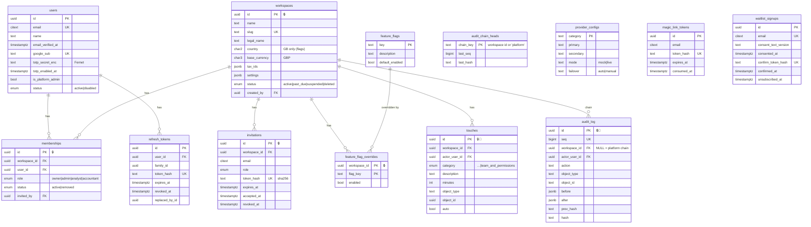

# Data model (ERD) — Phase 0

Every table has a UUID (v7) primary key, `created_at`/`updated_at` (`timestamptz`), and, for tenant tables, `workspace_id` with forced RLS (ADR-0004). 🔒 = RLS. 📜 = append-only.

Later phases add their entities (ledger, orders, plans, research and so on) with expand-only migrations. Workspace columns such as `stripe_account_id` and `plan` arrive in Phases 1 and 1B.
